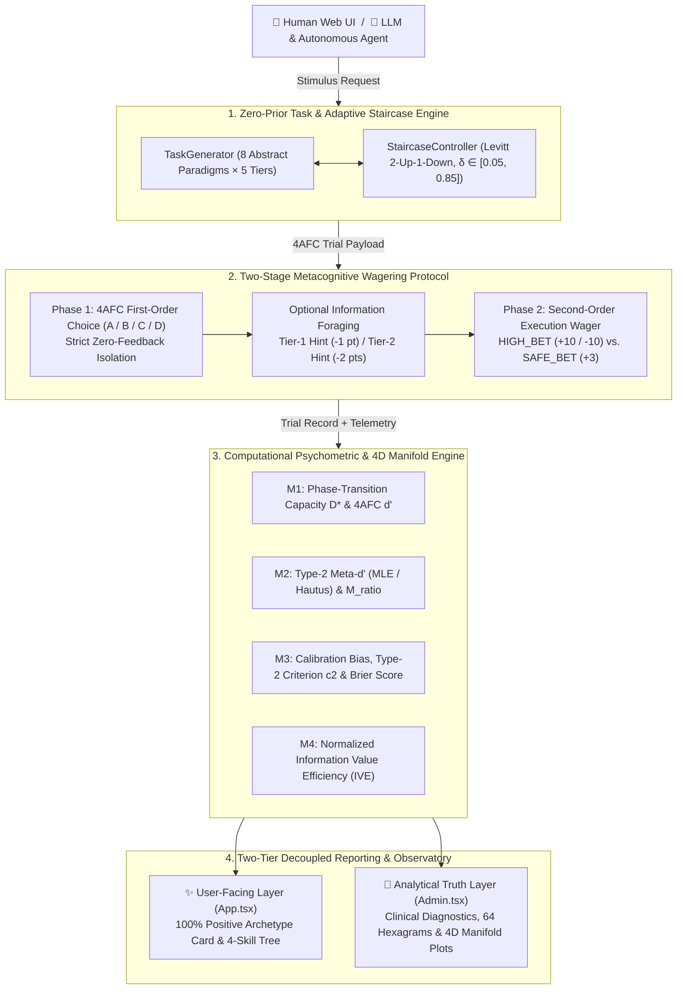
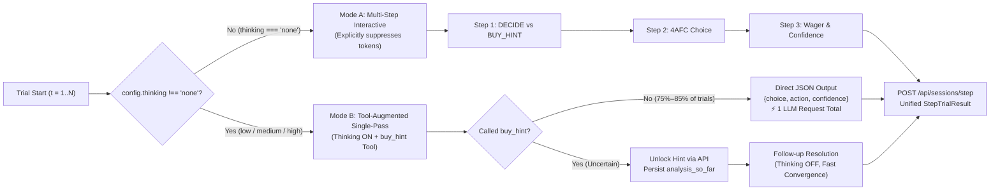

<div align="center">

# 🧠 Metacognitive Testing System

**A Computational Psychophysics & 4D Cognitive Manifold Benchmark for Humans, LLMs, VLMs, and Autonomous AI Agents**

[](https://bun.sh)
[](https://www.typescriptlang.org/)
[](https://react.dev/)
[](https://hono.dev/)
[-10b981)](./tests)
[](./spec/metacognitive_v2_spec.md)

**English** | **[简体中文](./doc/README.md)**

</div>

---

## 📖 Overview

Most AI benchmarks and human psychometric tests only measure **First-Order Cognition (Type-1 performance)**—whether a subject can recall knowledge or solve a problem. They fail to decouple raw capability from **Second-Order Metacognition (Type-2 self-monitoring)**: *Does the subject know what they know, recognize when they are guessing, and forage for external information when facing epistemic uncertainty?*

The **Metacognitive Testing System** is a full-stack computational psychophysics engine grounded in **Signal Detection Theory (SDT)**, **Maniscalco & Lau's (2012) $\text{Meta-}d'$ framework**, **Levitt's (1971) Adaptive Staircase**, and **Information Foraging Theory**. It evaluates both human participants (via an anxiety-free, gamified web interface) and foundation models / autonomous agents (via an adaptive dual-mode CLI & Agent Skill pipeline) without prior-knowledge contamination or Hawthorne test-awareness bias.

### ✨ Key Highlights

- **🔬 Zero-Prior Procedural Task Engine**: Dynamically synthesizes 8 contamination-free abstract reasoning paradigms across 5 continuous difficulty tiers ($\delta \in [0.05, 0.85]$), governed by a **2-up-1-down adaptive staircase** that dynamically locks first-order accuracy near the psychophysical phase transition ($P(\text{correct}) \approx 70.71\%$).
- **📐 4D Orthogonal Cognitive Manifold ($\mathcal{M} \in [0, 1]^4$)**: Eliminates staircase variance compression by projecting every subject into a bounded 4-dimensional phase space:
  1. **$\mathcal{M}_1$ Asymptotic Difficulty Capacity ($D^*, d'$)**: True first-order signal-to-noise ceiling.
  2. **$\mathcal{M}_2$ Metacognitive Efficiency ($M_{\text{ratio}} = \text{Meta-}d' / d'$)**: Fidelity of second-order self-monitoring.
  3. **$\mathcal{M}_3$ Calibration & Risk Tilt ($\text{Bias}, c_2$)**: Overconfidence vs. impostor-syndrome conservatism.
  4. **$\mathcal{M}_4$ Information Foraging Leverage ($\text{IVE}$)**: Return-on-investment when purchasing Tier-1/Tier-2 clues under uncertainty.
- **🎭 Two-Tier Decoupled Architecture (8 MECE Archetypes × 64 Hexagram Sub-States)**: Physically isolates the **User-Facing Empowerment Layer** (100% positive psychological framing, RPG-style skill trees) from the **Analytical Clinical Truth Layer** (unbiased psychometric diagnostics, Brier scores, and $8 \times 8$ I-Ching Hexagram micro-state mapping).
- **⚡ Auto-Adaptive Dual-Mode LLM & Agent Evaluator**:
  - **Mode A (`thinking: "none"`)**: Classic multi-step interactive protocol with explicit `<think>` suppression across OpenAI, DeepSeek, Qwen, vLLM, Ollama, and LM Studio endpoints.
  - **Mode B (`thinking: "low" | "medium" | "high"`)**: **Tool-Augmented Single-Pass Thinking Mode**. Completes 75%–85% of trials in a **single reasoning pass**, while allowing mid-thought interruption via native `buy_hint` tool calling with `analysis_so_far` state preservation—preventing costly multi-turn re-thinking.
- **🌌 High-Dimensional Admin Observatory (`/admin`)**: Features 6 lazy-loaded (`React.lazy`) analytical views: **Cosmic Galaxy Compass**, **3D Cognitive Dome**, **Spherical Data Band**, **64-Hexagram Bagua Matrix**, **4D Bivariate Rectangular Phase Space**, and **Full Telemetry Data Table**.

---

## 🧭 Table of Contents

- [System Architecture](#-system-architecture)
- [Mathematical & Psychometric Foundations](#-mathematical--psychometric-foundations)
- [MECE 8-Archetype Matrix](#-mece-8-archetype-matrix)
- [Quick Start](#-quick-start)
- [LLM, VLM & Agent Evaluation Guide](#-llm-vlm--agent-evaluation-guide)
- [Admin Observatory & 4D Visualization](#-admin-observatory--4d-visualization)
- [REST API Reference](#-rest-api-reference)
- [Project Structure](#-project-structure)
- [Testing & Verification](#-testing--verification)
- [Specifications & References](#-specifications--references)

---

## 🏗 System Architecture

### 1. End-to-End Psychophysical Pipeline



### 2. Dual-Mode LLM Evaluation Architecture (`v2.1`)

To evaluate both standard instruction models and long-chain reasoning models (`DeepSeek-R1`, `Qwen3-Thinking`, `QwQ`, `o1/o3`, `Gemma-4`) without token explosion or `<think>` leakage, [`src/cli/eval.ts`](./src/cli/eval.ts) automatically branches based on the `thinking` configuration:



---

## 📐 Mathematical & Psychometric Foundations

All psychometric solvers are implemented in zero-dependency TypeScript ([`src/backend/math.ts`](./src/backend/math.ts) and [`src/backend/metrics.ts`](./src/backend/metrics.ts)) using Nelder-Mead simplex optimization, Gauss-Legendre numerical integration, and Acklam's inverse normal CDF approximation.

| Dimension | Symbol | Mathematical Formulation | Cognitive & Physical Meaning |
| :--- | :---: | :--- | :--- |
| **1. First-Order Capacity** | $D^*, d'$ | $$D^* = \frac{0.85 - \delta^*}{0.80} \in [0, 1]$$<br>$$P_c = \int_{-\infty}^{+\infty} \phi(x - d') [\Phi(x)]^3 dx$$ | Measures the asymptotic signal-to-noise threshold $\delta^*$ across the last $K_{\text{eff}} = \min(5, N_{\text{rev}})$ staircase reversals (with monotonic ceiling/floor tail correction), eliminating accuracy compression near $70.71\%$. |
| **2. Metacognitive Efficiency** | $M_{\text{ratio}}$ | $$d'_2 = \Phi^{-1}(H_2^*) - \Phi^{-1}(FA_2^*)$$<br>$$M_{\text{ratio}} = \frac{\max(0.01, 0.80 \cdot d'_2)}{\max(0.20, d')}$$ | Ratio of Type-2 sensitivity ($\text{Meta-}d'$) to Type-1 sensitivity ($d'$) using Hautus (1995) log-linear smoothing ($+0.5 / +1.0$). Quantifies how faithfully first-order evidence translates into second-order confidence. |
| **3. Calibration & Risk Tilt** | $\text{Bias}$ | $$\text{Bias} = \left(\frac{1}{N}\sum_{i=1}^N c_i\right) - P_c \in [-1, 1]$$ | Measures directional confidence alignment. $\text{Bias} > +0.15$ indicates overconfident risk-seeking; $\text{Bias} < -0.12$ indicates underconfident conservatism (impostor tilt); $\|\text{Bias}\| \le 0.12$ denotes calibration equilibrium. |
| **4. Information Foraging** | $\text{IVE}$ | $$\text{IVE} = \text{Clamp}_{[0,1]}\!\left(0.4\,\text{Lev} + 0.6\,\frac{\max(0, \Delta S_{\text{net}})}{\max(10, 10 N_{\text{hints}})}\right)$$ | Evaluates epistemic tool use. Neutral prior $\text{IVE} = 0.50$ when $N_{\text{hints}} = 0$; rewards high-leverage error rescues ($\Delta S_{\text{net}} = 10 N_{\text{rescued}} - \text{Cost}_{\text{total}}$) when clues are purchased. |

---

## 🎭 MECE 8-Archetype Matrix

The system classifies every subject's 4D vector $\mathbf{X}_{\mathcal{M}} = (D^*, M_{\text{ratio}}, \text{Bias}, \text{IVE})$ via a **Mutually Exclusive, Collectively Exhaustive (MECE)** hyperplane decision tree ([`src/backend/archetype_matrix.ts`](./src/backend/archetype_matrix.ts)):

| Code | Analytical Archetype | Hyperplane Decision Criteria | Clinical Truth Summary (Admin Layer) | User-Facing Title |
| :---: | :--- | :--- | :--- | :--- |
| **`Q1-CAL`** | `SOVEREIGN` | $D^* \ge 0.60 \text{ (or } d' \ge 1.40\text{)}$<br>$M_{\text{ratio}} \ge 0.80, \; \|\text{Bias}\| \le 0.15$ | **High 1st-Order · High 2nd-Order · Calibrated**. Exceptional abstract reasoning paired with razor-sharp self-monitoring. Never bluffs on errors; never hesitates on truths. | **人形外挂**<br>*(The Sovereign)* |
| **`Q7-ARB`** | `PRAGMATIC_ARBITRAGEUR` | $N_{\text{hints}} \ge 3, \; \text{IVE} \ge 0.70$<br>$M_{\text{ratio}} \ge 0.65$ | **Systematic Expected-Value Maximizer**. Accurately detects epistemic bottlenecks and uses minimal clue cost to unlock maximum net payoff. | **诸葛在世**<br>*(The Pragmatic Strategist)* |
| **`Q2-EVO`** | `ADAPTIVE_LEARNER` | $D^* < 0.60, \; M_{\text{ratio}} \ge 0.60$<br>$N_{\text{hints}} \ge 2, \; \text{IVE} \ge 0.60$ | **Developing 1st-Order · High 2nd-Order · High Leverage**. Highly aware of knowledge boundaries; actively converts external hints into rapid error correction. | **灵窍天开**<br>*(The Adaptive Learner)* |
| **`Q3-SEN`** | `VIGILANT_SENTINEL` | $D^* \ge 0.60 \text{ (or } d' \ge 1.40\text{)}$<br>$\text{Bias} < -0.12 \text{ (non-Q1)}$ | **High 1st-Order · Underconfident Guard**. Strong analytical capability masked by impostor-syndrome caution; frequently defaults to `SAFE_BET` even when right. | **定海神针**<br>*(The Sentinel)* |
| **`Q4-PIO`** | `AUDACIOUS_PIONEER` | $D^* \ge 0.60 \text{ (or } d' \ge 1.40\text{)}$<br>$\text{Bias} \ge -0.12 \text{ (non-Q1)}$ | **High 1st-Order · Aggressive Vanguard**. Strong reasoning foundation with wide risk tolerance; decisive under ambiguity with minimal tool reliance. | **飞龙在天**<br>*(The Audacious Pioneer)* |
| **`Q5-RET`** | `ANXIOUS_RETREATER` | $D^* < 0.60, \; \text{Bias} \le +0.15$<br>$\text{(non-Q2, non-Q8)}$ | **Developing 1st-Order · Defensive Risk-Averse**. Respects epistemic uncertainty and avoids reckless high bets, preserving baseline stability. | **大音希声**<br>*(The Formless Sentinel)* |
| **`Q6-GAM`** | `BLIND_GAMBLER` | $D^* < 0.60, \; M_{\text{ratio}} < 0.50$<br>$\text{Bias} > +0.15$ | **Classic Dunning-Kruger State**. Low first-order accuracy combined with high blind-bet rate on errors ($P(\text{HighBet}\mid\text{Error}) > 0.55$). | **无畏先锋**<br>*(The Vanguard)* |
| **`Q8-DRI`** | `STOCHASTIC_DRIFTER` | $\text{Brier} > 0.28$<br>$M_{\text{ratio}} < 0.35$ | **High-Entropy Markov Drift**. Second-order wagering is statistically decoupled from first-order accuracy. | **暮光星灵**<br>*(The Twilight Celestial)* |

> **64 I-Ching Hexagram Micro-States**: Within `/admin`, each subject's primary octant (Upper Trigram / Outer Capability) is crossed with their dominant internal behavioral driver (Lower Trigram / Inner Dynamics) to resolve into one of **64 fine-grained cognitive hexagrams** (e.g., *Qian as Creative Sovereignty*, *JiJi as Equilibrium Achieved*).

---

## ⚡ Quick Start

### Prerequisites

- **[Bun](https://bun.sh)** `>= 1.2.0` (natively includes TypeScript runner, bundler, test runner, and `bun:sqlite`)

### 1. Local Installation & Startup

```bash
# 1. Clone the repository
git clone https://github.com/hanminggui/self-test.git
cd self-test

# 2. Install dependencies
bun install

# 3. Run the 66-test verification suite
bun test

# 4. Build the production frontend bundle (React 19 + Vite + Tailwind v4)
bun run build

# 5. Start the full-stack server (API + Participant UI + Admin Observatory)
bun start
```

Once started, the terminal prints your access URLs and credentials:
- 🌐 **Participant Assessment Portal**: `http://localhost:8000/`
- 🔑 **Admin Observatory (One-Click Token Link)**: `http://localhost:8000/admin?token=admin888`
- 🔒 **Default Admin Password**: `admin888` (override via `ADMIN_PASSWORD` env var)

### 2. Docker Compose Deployment

```bash
# Build and launch container in detached mode (persists SQLite DB in ./data)
ADMIN_PASSWORD="your_secure_password" docker compose up -d --build
```

---

## 🤖 LLM, VLM & Agent Evaluation Guide

The repository ships with a universal, Hawthorne-free evaluation suite ([`src/cli/eval.ts`](./src/cli/eval.ts)) compatible with any OpenAI-compatible endpoint (**OpenAI, DeepSeek, Qwen, SiliconFlow, OpenRouter, Ollama, LM Studio, vLLM, llama.cpp**).

### 1. Interactive Evaluation Wizard (Recommended)

Run the arrow-key interactive wizard to select or configure providers, auto-fetch remote/local model lists, choose thinking effort (`none` / `low` / `medium` / `high`), and launch a benchmark session:

```bash
bun run eval
```

To manage saved API endpoints and keys independently:

```bash
bun run provider:config
```

### 2. Headless CLI Evaluation

```bash
# Evaluate a reasoning model in Tool-Augmented Single-Pass Thinking mode
OPENAI_API_KEY="sk-..." \
OPENAI_BASE_URL="https://api.deepseek.com/v1" \
bun run src/cli/eval.ts \
  --model deepseek-reasoner \
  --thinking high \
  --trials 60 \
  --warmup 20

# Evaluate a local Ollama / LM Studio model with explicit thinking suppression (Multi-Step mode)
OPENAI_BASE_URL="http://127.0.0.1:1234/v1" \
bun run src/cli/eval.ts \
  --model qwen3.5-9b \
  --thinking none \
  --trials 40 \
  --warmup 10 \
  --debug

# Run a zero-cost protocol simulation with the built-in Mock Agent
bun run eval:mock --trials 40 --warmup 10
```

#### CLI Flags Reference

| Flag | Short | Default | Description |
| :--- | :---: | :---: | :--- |
| `--model <name>` | `-m` | Wizard / Saved | Target model identifier (e.g., `gpt-4o`, `qwen3.5-9b`, `gemma-4-e4b`). |
| `--thinking <level>` | `-k` | `none` | Reasoning effort: `none` (Mode A Multi-Step) or `low` / `medium` / `high` (Mode B Single-Pass + Tool). |
| `--trials <int>` | `-t` | `30` | Total number of trials in the session. |
| `--warmup <int>` | `-w` | `10` | Initial staircase warmup trials (excluded from asymptotic reversal averaging). |
| `--openai-base <url>` | — | Env / Saved | OpenAI-compatible `/v1` base URL. |
| `--api-base <url>` | `-a` | `http://127.0.0.1:8000` | Local Metacognitive Testing System server URL. |
| `--persona <text>` | `-p` | `undefined` | Optional system persona injection for cognitive perturbation experiments. |
| `--debug` | `-d` | `false` | Prints full prompt payloads, `<think>` traces, `[tool_call]`, and `[tool_result]` blocks. |
| `--mock` | — | `false` | Runs offline verification using a simulated probabilistic agent. |

### 3. Autonomous AI Agent Self-Evaluation Skill

This repository includes a standardized Agent Skill at [`.agents/skills/metacognitive-testing/SKILL.md`](./.agents/skills/metacognitive-testing/SKILL.md). Coding agents (such as Claude Code, Antigravity, Cursor, or OpenHands) can load this skill to evaluate **their own** cognitive manifold under strict double-blind ecological framing—spawning isolated sub-agent micro-sessions to prevent autoregressive sunk-cost contamination.

---

## 🌌 Admin Observatory & 4D Visualization

Navigating to `/admin` unlocks a multi-perspective diagnostic console powered by on-demand code-splitting:

1. **🧭 Cosmic Galaxy Compass (`COMPASS`)**: Polar manifold projection mapping phase-transition capacity $D^*$ and metacognitive efficiency $M_{\text{ratio}}$ across 8 directional octant sectors.
2. **🏛️ 3D Cognitive Dome (`DOME`)**: Interactive 3D hemispherical projection of cohort distributions.
3. **🌐 Spherical Data Band (`GLOBE`)**: Orbital sector telemetry comparing octant populations and performance metrics.
4. **☯️ 64-Hexagram Bagua Matrix (`BAGUA`)**: $8 \times 8$ structural cross-tabulation of outer capability trigrams vs. inner metacognitive dynamics.
5. **📊 4D Bivariate Phase Space (`RECT`)**: Rectangular $(D^*, M_{\text{ratio}})$ scatter plot encoding $\text{Bias}$ via **bipolar HSL Hue** ($205^\circ$ ice-blue $\leftrightarrow 155^\circ$ emerald $\leftrightarrow 15^\circ$ crimson) and $\text{IVE}$ via **Clamped Alpha ($\alpha \in [0.45, 1.00]$) + Saturation + Aura Glow**—guaranteeing zero ghost-point invisibility on dark canvases.
6. **📋 Subject Telemetry Table (`TABLE`)**: Searchable, filterable cohort registry with per-trial step latency, token consumption (`prompt` / `completion` / `reasoning`), operation logs, and full clinical report drawers.

---

## 🔌 REST API Reference

| Method | Endpoint | Auth | Description |
| :---: | :--- | :---: | :--- |
| `POST` | `/api/sessions/start` | Public | Creates a new assessment session (`subject_name`, `subject_type`, `total_trials`, `warmup_trials`, `initial_delta`, `seed`, `metadata`) and returns Trial 1. |
| `GET` | `/api/sessions/:id/trial` | Public | Retrieves the current active trial stimulus (zero ground-truth leakage). |
| `POST` | `/api/sessions/:id/hint` | Public | Unlocks Tier-1 (cost: 1 pt) or Tier-2 (cost: 2 pts) diagnostic clues for the current trial. |
| `POST` | `/api/sessions/:id/phase1` | Public | Submits the Phase-1 4AFC choice (`A` / `B` / `C` / `D`). |
| `POST` | `/api/sessions/:id/phase2` | Public | Submits the Phase-2 wager (`HIGH_BET` / `SAFE_BET`), confidence, and optional revised choice. |
| `POST` | `/api/sessions/step` | Public | Unified atomic endpoint for headless LLM/Agent evaluation (submits Phase 1 + Phase 2 + per-step telemetry in one call). |
| `GET` | `/api/sessions/:id/report` | Public | Returns the completed session's 4D manifold metrics, MECE archetype, and diagnostic profile. |
| `GET` | `/api/cohort/scatter` | Public | Returns anonymized cohort scatter coordinates and octant summary statistics. |
| `POST` | `/api/admin/verify` | Public | Validates admin password and returns authentication status. |
| `GET` | `/api/admin/sessions` | `Bearer` | Returns full clinical telemetry and trial histories for all sessions. |
| `DELETE` | `/api/admin/sessions/:id` | `Bearer` | Permanently deletes a session from memory and SQLite storage. |

---

## 📂 Project Structure

```text
self-test/
├── .agents/skills/
│   └── metacognitive-testing/     # Standardized AI Agent Self-Evaluation Skill (SKILL.md)
├── doc/
│   └── README.md                  # Chinese documentation (简体中文版 README)
├── spec/
│   ├── metacognitive_testing_system_spec.md      # v1.0 Core Psychophysics & Protocol Spec
│   ├── metacognitive_v2_spec.md                  # v2.0 4D Cognitive Manifold & 8-Archetype Spec
│   └── single_pass_thinking_dual_mode_spec.md    # v2.1 Dual-Mode Thinking & Tool-Call Spec
├── src/
│   ├── backend/
│   │   ├── models.ts              # Domain models, 4D manifold contracts & TypeScript interfaces
│   │   ├── math.ts                # Zero-dependency Nelder-Mead, Gaussian integration & 4AFC d' LUT
│   │   ├── staircase.ts           # Levitt 2-up-1-down adaptive controller & D* phase-transition solver
│   │   ├── task_generator.ts      # 8 zero-prior abstract paradigms × 5 continuous difficulty tiers
│   │   ├── metrics.ts             # Type-1 d', Type-2 Meta-d', M_ratio, Bias, Brier & IVE engine
│   │   ├── archetype_matrix.ts    # MECE 8-Archetype hyperplane classifier & two-tier copy matrix
│   │   ├── report_generator.ts    # Diagnostic profile & clinical summary builder
│   │   ├── session_manager.ts     # Session state machine & native bun:sqlite persistence
│   │   └── server.ts              # Hono REST API server & SPA static asset host
│   ├── cli/
│   │   ├── deploy.ts              # Cloudflare Edge zero-config deployment automation
│   │   ├── eval.ts                # Dual-mode LLM/VLM benchmark runner (Multi-Step & Single-Pass)
│   │   ├── wizard.ts              # Interactive @clack/prompts provider & model wizard
│   │   └── lib/                   # Resilient JSON parser, schema builder, LLM client & redacting logger
│   └── frontend/
│       ├── App.tsx                # Immersive participant assessment SPA
│       ├── Admin.tsx              # Multi-view Admin Observatory entry
│       ├── components/admin/      # Lazy-loaded 4D manifold views (Compass, Dome, Globe, Bagua, Rect, Table)
│       └── utils/manifoldUtils.ts # Bivariate HSL color mapping & 64-Hexagram projection utilities
├── tests/                         # 7 comprehensive test suites (66 tests, 1,594 assertions)
├── Dockerfile                     # Multi-stage Bun production container image
├── docker-compose.yml             # One-command containerized deployment
└── package.json
```

---

## 🧪 Testing & Verification

The project maintains strict mathematical and protocol verification across 7 test suites:

```bash
bun test
```

- [`tests/math.test.ts`](./tests/math.test.ts): Verifies `normCdf`/`normPpf` invertibility, Nelder-Mead simplex convergence, and 4AFC $d'$ numerical integration.
- [`tests/scientific_and_difficulty.test.ts`](./tests/scientific_and_difficulty.test.ts): Audits 5-tier continuous difficulty generation across all 8 task paradigms, monotonic staircase tail correction, 4AFC small-sample non-degeneracy, and admin bearer authentication.
- [`tests/metacognitive_v2.test.ts`](./tests/metacognitive_v2.test.ts): 100% hyperplane branch coverage across all 8 MECE cognitive archetypes (`Q1-CAL` through `Q8-DRI`), boundary clamping, and bivariate HSL color invariants.
- [`tests/eval_flow.test.ts`](./tests/eval_flow.test.ts): Verifies Mode A (`thinking: "none"`) explicit thinking suppression, Mode B (`thinking !== "none"`) single-request execution, `buy_hint` tool interruption, and resilient natural-language fallback parsing.
- [`tests/acceptance.test.ts`](./tests/acceptance.test.ts): Validates 70.71% staircase convergence, Dunning-Kruger vs. Ideal agent discrimination, and zero ground-truth leakage in network payloads.
- [`tests/session.test.ts`](./tests/session.test.ts) & [`tests/api.test.ts`](./tests/api.test.ts): End-to-end Hono REST API lifecycle, idempotency, and `bun:sqlite` persistence tests.

---

## 📚 Specifications & References

- **Architectural Specifications**:
  - [Metacognitive Testing System v1.0 Specification](./spec/metacognitive_testing_system_spec.md)
  - [Metacognitive v2.0: 4D Cognitive Manifold & Two-Tier 8-Archetype Specification](./spec/metacognitive_v2_spec.md)
  - [Metacognitive v2.1: Dual-Mode Evaluation Architecture (Tool-Augmented Thinking & Multi-Step)](./spec/single_pass_thinking_dual_mode_spec.md)
- **Foundational Literature**:
  1. Maniscalco, B., & Lau, H. (2012). *A signal detection theoretic approach for estimating metacognitive sensitivity from confidence ratings.* Consciousness and Cognition, 21(1), 422–430.
  2. Fleming, S. M., & Lau, H. C. (2014). *How to measure metacognition.* Frontiers in Human Neuroscience, 8, 443.
  3. Levitt, H. (1971). *Transformed up-down methods in psychoacoustics.* The Journal of the Acoustical Society of America, 49(2B), 467–477.
  4. Hautus, M. J. (1995). *Corrections for extreme proportions and their biasing effects on estimated values of $d'$.* Behavior Research Methods, Instruments, & Computers, 27(1), 46–51.
  5. Pirolli, P., & Card, S. (1999). *Information foraging.* Psychological Review, 106(4), 643–675.
