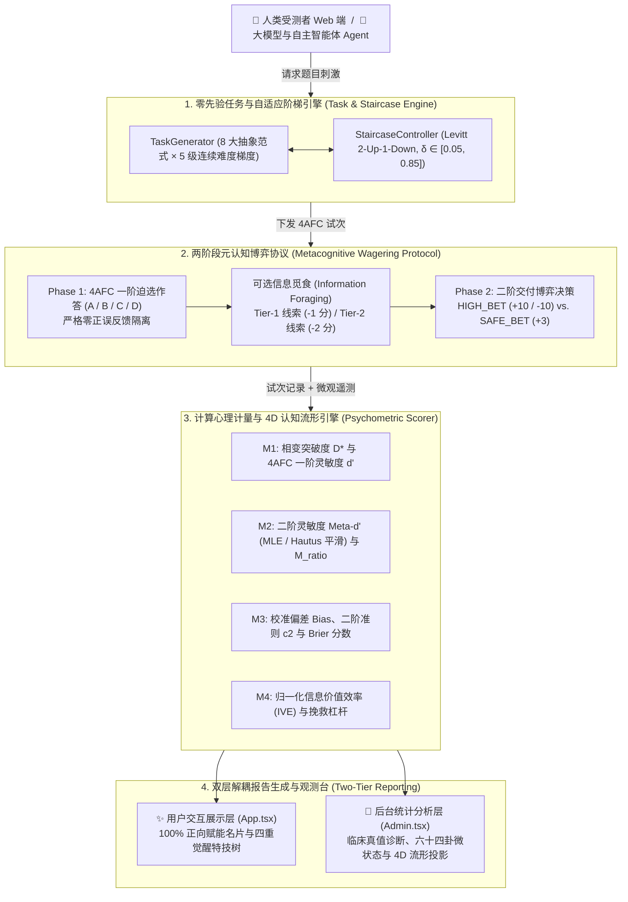
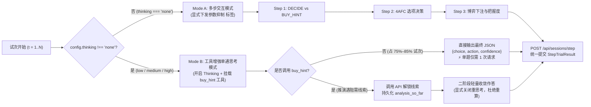

<div align="center">

# 🧠 二元认知评测系统 (Metacognitive Testing System)

**面向人类受试者、大语言/视觉模型（LLM/VLM）与自主智能体（AI Agents）的计算心理物理学与 4D 认知流形评测基准**

[](https://bun.sh)
[](https://www.typescriptlang.org/)
[](https://react.dev/)
[](https://hono.dev/)
[-10b981)](../tests)
[](../spec/metacognitive_v2_spec.md)

**[English](../README.md)** | **简体中文**

</div>

---

## 📖 项目概述

传统的 AI 基准测试与人类心理测量学往往仅局限于度量**一阶认知（Type-1 Performance，即“会不会做题、知识储备有多少”）**，而无法将底层推演能力与**二阶元认知（Type-2 Metacognition，即“自我监控与边界觉察”）**解耦：*受试者是否清楚自己知道什么？在面对认知盲区时能否敏锐察觉不确定性？能否以最小信息成本调用外部线索完成逻辑修正？*

**二元认知评测系统（Metacognitive Testing System）** 是一套严格建立在**信号检测论（SDT）**、**Maniscalco & Lau (2012) $\text{Meta-}d'$ 框架**、**Levitt (1971) 自适应心理物理阶梯法**与**信息觅食理论（Information Foraging Theory）**之上的全栈计算认知评测引擎。系统既支持人类受试者通过零焦虑的沉浸式 Web 界面参测，也支持任意大语言模型（LLM/VLM）与智能体（Active AI Agents）在无先验知识污染、无霍桑效应（测试暴露偏见）的生态环境下完成自动化评测。

### ✨ 核心特性

- **🔬 零先验动态抽象任务生成引擎**：实时程序化合成 8 大无背诵污染的抽象逻辑推理范式（涵盖符号密码置换、点阵密度、拓扑连通、模运算同余、结构守恒等），跨越 5 级连续难度梯度（$\delta \in [0.05, 0.85]$），并由 **Levitt 2-up-1-down 自适应阶梯控制器**动态追踪，将受试者的一阶准确率严密锚定在心理物理学相变临界点（$P(\text{correct}) \approx 70.71\%$）。
- **📐 4D 正交认知流形（$\mathcal{M} \in [0, 1]^4$）**：彻底消除自适应阶梯带来的原始胜率方差压缩，将每位受试者投影至严格有界的四维正交相空间：
  1. **$\mathcal{M}_1$ 一元相变突破度（$D^*, d'$）**：度量底层抽象认知坍缩的临界信噪比上限；
  2. **$\mathcal{M}_2$ 元认知转化效率（$M_{\text{ratio}} = \text{Meta-}d' / d'$）**：剥离一阶实力干扰后的二阶自我监控保真度；
  3. **$\mathcal{M}_3$ 二元决策偏向倾角（$\text{Bias}, c_2$）**：量化过度自信冒险（达克效应）与过度谨慎避险（冒名顶替综合征）；
  4. **$\mathcal{M}_4$ 归一化信息觅食弹性（$\text{IVE}$）**：度量在不确定迷雾中购买 Tier-1 / Tier-2 线索实现逆转的投入产出杠杆。
- **🎭 双层物理隔离架构（8 大 MECE 认知画像 × 64 卦微状态矩阵）**：将**用户交互展示层**（100% 正向心理学赋能、本命角色名片与四重技能树）与**后台临床分析层**（客观心理计量学参数、Brier 预测误差、临床真值诊断与 $8 \times 8$ 周易六十四卦细粒度认知矩阵）彻底解耦。
- **⚡ 自适应双模大模型与智能体评测管线（`v2.1`）**：
  - **Mode A（`thinking: "none"` 多步交互模式）**：显式向 OpenAI / DeepSeek / Qwen / Ollama / LM Studio 下发思考抑制指令，杜绝隐式 `<think>` 泄漏；
  - **Mode B（`thinking: "low" | "medium" | "high"` 工具增强单通思考模式）**：在无需线索的试次中仅需 **1 次 LLM 请求**即可完成推理与二阶博弈；当推演遇阻时支持通过原生 `buy_hint` 工具调用按需调阅线索，并通过 `analysis_so_far` 持久化中间推导结论，彻底根除多轮重复重算。
- **🌌 高维管理观测台（`/admin`）**：基于 `React.lazy` 动态按需代码分割，内置 **宇宙星系罗盘（`COMPASS`）**、**3D 认知穹顶（`DOME`）**、**球面数据环带（`GLOBE`）**、**六十四卦八卦推演矩阵（`BAGUA`）**、**4D 双变量矩形相空间（`RECT`）** 与 **全链路受试者明细台账（`TABLE`）** 六大科研级视图。

---

## 🧭 目录

- [系统架构与核心链路](#-系统架构与核心链路)
- [数学与计算心理计量学规范](#-数学与计算心理计量学规范)
- [MECE 8 大认知画像对照矩阵](#-mece-8-大认知画像对照矩阵)
- [快速启动指南](#-快速启动指南)
- [大模型（LLM/VLM）与智能体评测指南](#-大模型llmvlm与智能体评测指南)
- [管理观测台与 4D 可视化规范](#-管理观测台与-4d-可视化规范)
- [REST API 接口参考](#-rest-api-接口参考)
- [工程目录结构](#-工程目录结构)
- [自动化测试与质量保障](#-自动化测试与质量保障)
- [规格说明书与学术参考文献](#-规格说明书与学术参考文献)

---

## 🏗 系统架构与核心链路

### 1. 端到端计算心理物理学流水线



### 2. 双模大模型自适应评测架构（`v2.1`）

为了兼顾常规指令模型与长思维链推理模型（如 `DeepSeek-R1`、`Qwen3-Thinking`、`QwQ`、`Gemma-4` 等），[`src/cli/eval.ts`](../src/cli/eval.ts) 根据 `thinking` 配置自动切换执行拓扑，同时 100% 共享底层计分与遥测数据结构：



---

## 📐 数学与计算心理计量学规范

核心求解器均在零第三方重依赖的纯 TypeScript 中实现（详见 [`src/backend/math.ts`](../src/backend/math.ts) 与 [`src/backend/metrics.ts`](../src/backend/metrics.ts)），内置 Nelder-Mead 单纯形优化、高斯数值积分与 4AFC 高精度查表插值。

| 流形维度 | 符号 | 核心数学定义与计算规约 | 认知物理学意义 |
| :--- | :---: | :--- | :--- |
| **1. 一元相变突破度** | $D^*, d'$ | $$D^* = \frac{0.85 - \delta^*}{0.80} \in [0, 1]$$<br>$$P_c = \int_{-\infty}^{+\infty} \phi(x - d') [\Phi(x)]^3 dx$$ | 提取最后 $K_{\text{eff}} = \min(5, N_{\text{rev}})$ 次阶梯反转的渐近差异阈值 $\delta^*$（含单调撞顶/撞底尾端修正），彻底根除 $70.71\%$ 胜率方差压缩假象。 |
| **2. 元认知转化效率** | $M_{\text{ratio}}$ | $$d'_2 = \Phi^{-1}(H_2^*) - \Phi^{-1}(FA_2^*)$$<br>$$M_{\text{ratio}} = \frac{\max(0.01, 0.80 \cdot d'_2)}{\max(0.20, d')}$$ | 引入 Hautus (1995) 对数线性平滑（$+0.5 / +1.0$）计算二阶灵敏度 $\text{Meta-}d'$ 与一阶 $d'$ 的比值，精准衡量“知己所知、不知所不知”的信息转化保真度。 |
| **3. 二元决策偏向倾角** | $\text{Bias}$ | $$\text{Bias} = \left(\frac{1}{N}\sum_{i=1}^N c_i\right) - P_c \in [-1, 1]$$ | 度量主观置信度与客观命中率的系统性偏离。$\text{Bias} > +0.15$ 表征过度自信盲赌；$\text{Bias} < -0.12$ 表征过度谨慎防御；$\|\text{Bias}\| \le 0.12$ 表征知行自洽。 |
| **4. 信息觅食杠杆率** | $\text{IVE}$ | $$\text{IVE} = \text{Clamp}_{[0,1]}\!\left(0.4\,\text{Lev} + 0.6\,\frac{\max(0, \Delta S_{\text{net}})}{\max(10, 10 N_{\text{hints}})}\right)$$ | 评估面对认知迷雾时的外部工具利用效率。当 $N_{\text{hints}} = 0$ 时取中性先验 $0.50$；当购买线索并成功挽救错题时，按净胜收益 $\Delta S_{\text{net}}$ 与转化杠杆赋予高分。 |

---

## 🎭 MECE 8 大认知画像对照矩阵

系统通过严格单向、互斥且完备（MECE）的超平面判别树（[`src/backend/archetype_matrix.ts`](../src/backend/archetype_matrix.ts)）将 4D 认知流形向量 $\mathbf{X}_{\mathcal{M}} = (D^*, M_{\text{ratio}}, \text{Bias}, \text{IVE})$ 映射至 8 大稳态吸引子画像：

| 画像编码 | 统计层枚举标识 | 数学超平面判定硬约束 | 后台统计层：客观临床真值描述 | 前台展示层：角色称号与金句 |
| :---: | :--- | :--- | :--- | :--- |
| **`Q1-CAL`** | `SOVEREIGN` | $D^* \ge 0.60 \text{ (或 } d' \ge 1.40\text{)}$<br>$M_{\text{ratio}} \ge 0.80, \; \|\text{Bias}\| \le 0.15$ | **高一元·高二元·知行自洽**。底层抽象推演强，二阶敏感度极高，错题绝不下高注，做对从不犹疑，战绩期望极优。 | **人形外挂** *(The Sovereign)*<br>「你开了 · 诗人握持」 |
| **`Q7-ARB`** | `PRAGMATIC_ARBITRAGEUR` | $N_{\text{hints}} \ge 3, \; \text{IVE} \ge 0.70$<br>$M_{\text{ratio}} \ge 0.65$ | **中高一元·高二元·系统性概率套利**。纯粹的数学期望最大化者，把握高则全额下注，存疑则果断购入线索穿透。 | **诸葛在世** *(The Pragmatic Strategist)*<br>「羽扇纶巾 · 算无遗策」 |
| **`Q2-EVO`** | `ADAPTIVE_LEARNER` | $D^* < 0.60, \; M_{\text{ratio}} \ge 0.60$<br>$N_{\text{hints}} \ge 2, \; \text{IVE} \ge 0.60$ | **低一元·高二元·高信息杠杆**。自我认知边界极清醒，极擅长利用 Tier 1/2 线索挽救失误，受训适应性（Coachability）极高。 | **灵窍天开** *(The Adaptive Learner)*<br>「心开一窍 · 融会贯通」 |
| **`Q3-SEN`** | `VIGILANT_SENTINEL` | $D^* \ge 0.60 \text{ (或 } d' \ge 1.40\text{)}$<br>$\text{Bias} < -0.12 \text{ (非 Q1)}$ | **高一元·审慎二元·过度谨慎**。一元硬实力扎实，但存在冒名顶替偏向，做对时仍频繁下保底注，守底极稳。 | **定海神针** *(The Sentinel)*<br>「渊渟岳峙 · 固若金汤」 |
| **`Q4-PIO`** | `AUDACIOUS_PIONEER` | $D^* \ge 0.60 \text{ (或 } d' \ge 1.40\text{)}$<br>$\text{Bias} \ge -0.12 \text{ (非 Q1)}$ | **高一元·激进冒险·进攻破局**。推演底蕴扎实，二阶风控较宽，遇到偶发盲区依然果断拍板前压，极少依赖线索。 | **飞龙在天** *(The Audacious Pioneer)*<br>「飞龙骑脸 · 我怎么输」 |
| **`Q5-RET`** | `ANXIOUS_RETREATER` | $D^* < 0.60, \; \text{Bias} \le +0.15$<br>$\text{(非 Q2, 非 Q8)}$ | **低一元·防御避险·审慎守护**。推演处于探索期，对未知具有高度敬畏，下注克制审慎，绝不盲目梭哈。 | **大音希声** *(The Formless Sentinel)*<br>「大音希声 · 大象无形」 |
| **`Q6-GAM`** | `BLIND_GAMBLER` | $D^* < 0.60, \; M_{\text{ratio}} < 0.50$<br>$\text{Bias} > +0.15$ | **低一元·低二元·达克自负**。典型达克效应态，错题高注率极高（$P(\text{HighBet}\mid\text{Error}) > 0.55$），感知不到认知陷阱。 | **无畏先锋** *(The Vanguard)*<br>「左手高伤害 · 右手伤害高」 |
| **`Q8-DRI`** | `STOCHASTIC_DRIFTER` | $\text{Brier} > 0.28$<br>$M_{\text{ratio}} < 0.35$ | **决策脱钩·纯高熵漫游态**。二阶下注动作与一阶客观正误完全解耦，呈现马尔可夫随机游走特征。 | **暮光星灵** *(The Twilight Celestial)*<br>「逍遥天地 · 不滞于物」 |

> **☯️ 周易六十四卦细粒度认知矩阵**：在管理后台中，系统进一步将受试者的主象限（上卦/外卦：宏观显性能力）与内在副驱动力（下卦/内卦：微观心智动力）正交复合，精准落位至 **$8 \times 8 = 64$ 种细粒度认知卦象**（如「乾为天·绝对统御」、「水火既济·精算借力」等）。

---

## ⚡ 快速启动指南

### 环境依赖

- **[Bun](https://bun.sh)** `>= 1.2.0`（原生集成 TypeScript 运行时、打包器、`bun:test` 测试框架与 `bun:sqlite` 数据库）

### 1. 本地源码安装与启动

```bash
# 1. 克隆仓库
git clone https://github.com/hanminggui/self-test.git
cd self-test

# 2. 安装依赖
bun install

# 3. 运行全套 66 项科学计算与协议验收测试
bun test

# 4. 编译生产环境前端静态资产 (React 19 + Vite + Tailwind CSS v4)
bun run build

# 5. 启动全栈服务 (同时托管 REST API、受测者 SPA 与 /admin 管理观测台)
bun start
```

服务启动后，终端将自动打印访问地址与管理端凭证：
- 🌐 **受测者沉浸式答题入口**：`http://localhost:8000/`
- 🔑 **管理观测台一键免密链接**：`http://localhost:8000/admin?token=admin888`
- 🔒 **管理员默认密码**：`admin888`（可通过环境变量 `ADMIN_PASSWORD` 自定义）

### 2. Docker Compose 容器化一键部署

```bash
# 编译镜像并在后台启动服务 (SQLite 数据自动持久化挂载至 ./data 目录)
ADMIN_PASSWORD="your_secure_password" docker compose up -d --build
```

---

## 🤖 大模型（LLM/VLM）与智能体评测指南

本项目内置零剧透、零霍桑效应污染的通用大模型评测引擎（[`src/cli/eval.ts`](../src/cli/eval.ts)），无缝支持任何兼容 OpenAI 接口规范的云端或本地推理端点（**OpenAI、DeepSeek、Qwen、硅基流动 SiliconFlow、OpenRouter、Ollama、LM Studio、vLLM、llama.cpp**）。

### 1. 交互式向导评测（推荐）

直接运行交互式向导，使用方向键选择或新增服务商、自动拉取远端/本地模型列表、配置思考强度（`none` / `low` / `medium` / `high`）并一键开启评测：

```bash
bun run eval
```

如需单独管理已保存的服务商端点与 API Key：

```bash
bun run provider:config
```

### 2. 命令行无头（Headless）批量评测

```bash
# 评测深度推理模型 (自动启用 Mode B 工具增强单通思考模式)
OPENAI_API_KEY="sk-..." \
OPENAI_BASE_URL="https://api.deepseek.com/v1" \
bun run src/cli/eval.ts \
  --model deepseek-reasoner \
  --thinking high \
  --trials 60 \
  --warmup 20

# 评测本地 LM Studio / Ollama 模型并显式关闭思考 (启用 Mode A 多步交互模式)
OPENAI_BASE_URL="http://127.0.0.1:1234/v1" \
bun run src/cli/eval.ts \
  --model qwen3.5-9b \
  --thinking none \
  --trials 40 \
  --warmup 10 \
  --debug

# 无需 API Key，使用内置概率仿真 Agent 跑通全流程协议校验
bun run eval:mock --trials 40 --warmup 10
```

#### CLI 命令行参数一览表

| 参数 | 简写 | 默认值 | 说明 |
| :--- | :---: | :---: | :--- |
| `--model <name>` | `-m` | 向导 / 缓存 | 被测模型名称标识（如 `gpt-4o`、`qwen3.5-9b`、`gemma-4-e4b`）。 |
| `--thinking <level>` | `-k` | `none` | 思考强度：`none`（Mode A 多步模式）或 `low` / `medium` / `high`（Mode B 单通思考+工具调用模式）。 |
| `--trials <int>` | `-t` | `30` | 单次评测会话的总试次数。 |
| `--warmup <int>` | `-w` | `10` | 前置阶梯自适应预热轮数（预热期反转不计入渐近相变点 $D^*$ 均值）。 |
| `--openai-base <url>` | — | 环境变量 / 缓存 | OpenAI 兼容接口的 `/v1` 基础 URL。 |
| `--api-base <url>` | `-a` | `http://127.0.0.1:8000` | 本地二元认知评测服务端地址。 |
| `--persona <text>` | `-p` | `undefined` | 可选系统人设注入（用于研究不同性格提示词对模型元认知校准偏差的扰动）。 |
| `--debug` | `-d` | `false` | 实时打印完整 Prompt 报文、`<think>` 思维链、`[tool_call]` 与 `[tool_result]` 明细。 |
| `--mock` | — | `false` | 使用内置仿真 Agent 执行离线基准测试。 |

### 3. 自主智能体（Active AI Agent）内生自评 Skill

仓库在 [`.agents/skills/metacognitive-testing/SKILL.md`](../.agents/skills/metacognitive-testing/SKILL.md) 中内置了标准化智能体元认知自评 Skill。支持 Skill 协议的智能体（如 Claude Code、Antigravity、Cursor 等）可直接加载该规范，在严格双盲无剧透的自然推演心智框架下，通过派发隔离微会话（Subagent Micro-Sessions）对**智能体自身**进行 4D 认知流形测量并输出深度自省诊断报告。

---

## 🌌 管理观测台与 4D 可视化规范

访问 `/admin` 即可进入多维科研观测控制台（各视图通过 `React.lazy` 按需异步加载，零首屏冗余开销）：

1. **🧭 宇宙星系罗盘（`COMPASS`）**：极坐标流形投影，直观呈现受试者在八大认知星区（Octants）中的角向落位与径向能力。
2. **🏛️ 3D 认知穹顶（`DOME`）**：交互式三维半球体空间投影，支持立体旋转检视群体分布。
3. **🌐 球面数据环带（`GLOBE`）**：环绕式星区遥测看板，横向对比八大画像族群的占比与核心均值。
4. **☯️ 六十四卦八卦矩阵（`BAGUA`）**：基于「外卦（主象限）× 内卦（副驱动力）」的 $8 \times 8$ 周易六十四卦精细化拓扑矩阵。
5. **📊 4D 双变量矩形相空间（`RECT`）**：以相变突破度 $D^*$ 为 X 轴、元认知效率 $M_{\text{ratio}}$ 为 Y 轴，通过**双极 HSL 色相**（$205^\circ$ 冰蓝 $\leftrightarrow 155^\circ$ 翡翠绿 $\leftrightarrow 15^\circ$ 炽橙红）编码决策倾角 $\text{Bias}$，并通过**保底透明度（$\alpha \in [0.45, 1.00]$）+ 饱和度 + 高杠杆外发光（Aura Glow）**编码信息觅食杠杆 $\text{IVE}$，彻底杜绝深色背景下的“幽灵点隐形”问题。
6. **📋 受试者全明细台账（`TABLE`）**：支持关键词检索、画像标签过滤、逐题单步耗时与 Token 消耗（`Prompt` / `Completion` / `Reasoning`）审计、操作序列回放及临床诊断抽屉。

---

## 🔌 REST API 接口参考

| 方法 | 路由端点 | 鉴权 | 功能说明 |
| :---: | :--- | :---: | :--- |
| `POST` | `/api/sessions/start` | 公开 | 创建新的评测会话（支持配置 `subject_name`、`subject_type`、`total_trials`、`warmup_trials`、`initial_delta`、`seed`、`metadata`）并返回第 1 题。 |
| `GET` | `/api/sessions/:id/trial` | 公开 | 获取当前试次的题目载荷（严格剥离标准答案与权重元数据，防止作弊泄漏）。 |
| `POST` | `/api/sessions/:id/hint` | 公开 | 为当前试次按序解锁 Tier-1（消耗 1 分）或 Tier-2（消耗 2 分）辅助诊断线索。 |
| `POST` | `/api/sessions/:id/phase1` | 公开 | 提交一阶段（Phase 1）四选一初答选项（`A` / `B` / `C` / `D`）。 |
| `POST` | `/api/sessions/:id/phase2` | 公开 | 提交二阶段（Phase 2）交付博弈策略（`HIGH_BET` / `SAFE_BET`）、把握度及可选修正答案。 |
| `POST` | `/api/sessions/step` | 公开 | 面向 CLI/Agent 的原子化单步提交接口（一次性完成一阶作答、二阶下注与单步 Token/耗时遥测记录）。 |
| `GET` | `/api/sessions/:id/report` | 公开 | 获取已完成会话的完整 4D 认知流形指标、MECE 画像与双层诊断报告。 |
| `GET` | `/api/cohort/scatter` | 公开 | 获取脱敏后的群体散点坐标与八星区统计摘要。 |
| `POST` | `/api/admin/verify` | 公开 | 校验管理员访问口令。 |
| `GET` | `/api/admin/sessions` | `Bearer` | 获取全部受试者会话的完整临床真值数据与逐题历史明细。 |
| `DELETE` | `/api/admin/sessions/:id` | `Bearer` | 从内存与 SQLite 数据库中永久删除指定评测会话。 |

---

## 📂 工程目录结构

```text
self-test/
├── .agents/skills/
│   └── metacognitive-testing/     # 智能体内生元认知自评 Skill 规范 (SKILL.md)
├── doc/
│   └── README.md                  # 简体中文版项目文档 (当前文件)
├── spec/
│   ├── metacognitive_testing_system_spec.md      # v1.0 核心心理物理学与二阶段博弈协议规范
│   ├── metacognitive_v2_spec.md                  # v2.0 4D 认知流形与双层 8 画像架构规范
│   └── single_pass_thinking_dual_mode_spec.md    # v2.1 工具增强单通思考与多步双模评测规范
├── src/
│   ├── backend/
│   │   ├── models.ts              # 核心领域数据模型、4D 流形契约与 TypeScript 强类型定义
│   │   ├── math.ts                # 零依赖数学库 (Nelder-Mead 单纯形、高斯积分、4AFC d' 高精度查表)
│   │   ├── staircase.ts           # Levitt 2-up-1-down 自适应阶梯控制器与 D* 相变突破度求解器
│   │   ├── task_generator.ts      # 8 大零先验抽象推理范式 × 5 级连续难度梯度动态生成器
│   │   ├── metrics.ts             # Type-1 d'、Type-2 Meta-d'、M_ratio、Bias、Brier 与 IVE 计量引擎
│   │   ├── archetype_matrix.ts    # MECE 8 大认知画像超平面分类器与双层文案映射字典
│   │   ├── report_generator.ts    # 诊断画像与临床真值摘要生成器
│   │   ├── session_manager.ts     # 会话状态机、幂等性保障与 bun:sqlite 原生持久化
│   │   └── server.ts              # Hono REST API 服务端与前端 SPA 静态资源托管
│   ├── cli/
│   │   ├── eval.ts                # 双模大模型/视觉模型自动化评测引擎 (Multi-Step & Single-Pass)
│   │   ├── wizard.ts              # 基于 @clack/prompts 的交互式服务商与模型配置向导
│   │   └── lib/                   # 韧性 JSON 解析器、Schema 构建器、LLM 客户端与脱敏日志器
│   └── frontend/
│       ├── App.tsx                # 受测者沉浸式零焦虑交互界面
│       ├── Admin.tsx              # 多视图管理观测台主入口
│       ├── components/admin/      # 按需懒加载的 6 大高维可视化视图组件与抽屉
│       └── utils/manifoldUtils.ts # 4D 双变量 HSL 色彩映射与周易六十四卦复合推演工具函数
├── tests/                         # 7 大自动化测试套件 (66 项测试，1,594 次断言校验)
├── Dockerfile                     # 多阶段构建 Bun 生产环境容器镜像
├── docker-compose.yml             # 容器化一键编排配置
└── README.md                      # 英文版主文档 (English README)
```

---

## 🧪 自动化测试与质量保障

项目包含 7 个自动化测试文件、共 **66 个测试用例（1,594 次 `expect()` 断言）**，在 Bun 运行时下仅需约 `150ms` 即可全部通过：

```bash
bun test
```

- [`tests/math.test.ts`](../tests/math.test.ts)：验证正态分布累积函数 `normCdf` 与逆函数 `normPpf` 的互逆精度、Nelder-Mead 多维优化收敛性及 4AFC $d'$ 数值积分准确性。
- [`tests/scientific_and_difficulty.test.ts`](../tests/scientific_and_difficulty.test.ts)：审计 8 大题型 × 5 级连续难度梯度的无重复选项与算术严密性、单调尾端相变点 $D^*$ 修正、重度线索防虚高机制及管理端 Bearer 鉴权。
- [`tests/metacognitive_v2.test.ts`](../tests/metacognitive_v2.test.ts)：覆盖 `Q1-CAL` 至 `Q8-DRI` 全部 8 大 MECE 画像超平面分支、极值边界保护以及 4D-to-2D 双变量色彩映射防隐形不变量。
- [`tests/eval_flow.test.ts`](../tests/eval_flow.test.ts)：验证 Mode A 显式思考抑制、Mode B 单通思考一次请求闭环、`buy_hint` 工具中断续传以及网关剥离 Schema 时的自然语言韧性解析。
- [`tests/acceptance.test.ts`](../tests/acceptance.test.ts)：验证 Spec §6 质量基准（70.71% 阶梯收敛、达克效应盲赌 Agent 与理想自知 Agent 区分度、网络载荷零答案泄漏）。
- [`tests/session.test.ts`](../tests/session.test.ts) & [`tests/api.test.ts`](../tests/api.test.ts)：验证端到端会话生命周期、重复提交幂等性与 `bun:sqlite` 持久化。

---

## 📚 规格说明书与学术参考文献

- **核心工程架构规范**：
  - [二元认知评测系统 v1.0 核心规格说明书](../spec/metacognitive_testing_system_spec.md)
  - [二元认知评测系统 v2.0：4D 认知流形与双层 8 画像架构规范](../spec/metacognitive_v2_spec.md)
  - [二元认知评测系统 v2.1：工具增强单通思考与多步双模评测规范](../spec/single_pass_thinking_dual_mode_spec.md)
- **基础认知科学与心理物理学文献**：
  1. Maniscalco, B., & Lau, H. (2012). *A signal detection theoretic approach for estimating metacognitive sensitivity from confidence ratings.* Consciousness and Cognition, 21(1), 422–430.
  2. Fleming, S. M., & Lau, H. C. (2014). *How to measure metacognition.* Frontiers in Human Neuroscience, 8, 443.
  3. Levitt, H. (1971). *Transformed up-down methods in psychoacoustics.* The Journal of the Acoustical Society of America, 49(2B), 467–477.
  4. Hautus, M. J. (1995). *Corrections for extreme proportions and their biasing effects on estimated values of $d'$.* Behavior Research Methods, Instruments, & Computers, 27(1), 46–51.
  5. Pirolli, P., & Card, S. (1999). *Information foraging.* Psychological Review, 106(4), 643–675.
