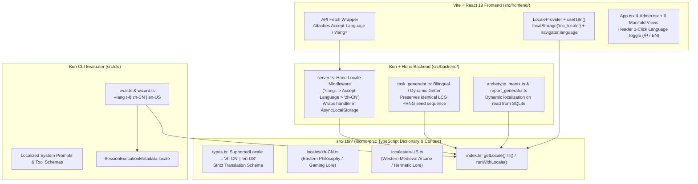

# Metacognitive v2.2: Full-Stack Isomorphic i18n & Western Arcane Archetype Localization Specification (`i18n_spec.md`)

## 1. Problem Statement & Goals

The Metacognitive Testing System currently hardcodes Simplified Chinese (`zh-CN`) strings across all four layers of its stack:
1. **Web Subject Portal & Admin Dashboard (`src/frontend/`)**: UI controls, interactive instructions, 4D cognitive manifold visualizations (Bagua Diagram, Cognitive Dome, Cosmic Galaxy Compass, Spherical Data Band, Rectangular Phase View, Subject Data Table), and diagnostic modals.
2. **Dynamic Psychometric Task & Diagnostic Hint Generator (`src/backend/task_generator.ts`)**: All 8 cognitive paradigms across 5 difficulty tiers generate Chinese task prompts and 2-tier diagnostic elimination hints (`hint_tier1`, `hint_tier2`).
3. **Diagnostic Report & 8-Archetype Matrix (`src/backend/archetype_matrix.ts`, `src/backend/report_generator.ts`, `src/backend/codename_generator.ts`)**: Uses Eastern philosophical, I Ching (Bagua), and gaming metaphors (e.g., *人形外挂*, *灵窍天开*, *定海神针*, *飞龙在天*, *大音希声*, *无畏先锋*, *诸葛在世*, *暮光星灵*), which are serialized into SQLite (`data/sessions.sqlite`).
4. **Universal LLM CLI Evaluator (`src/cli/eval.ts`, `src/cli/wizard.ts`, `src/cli/lib/schema_builder.ts`)**: Game rules system prompts, step instructions, tool schemas (`buy_hint`), and interactive `@clack/prompts` wizard messages are all in Chinese.

### Core Objectives
- **Full-Stack Bilingual Coverage (`zh-CN` & `en-US`)**: Support seamless switching between Simplified Chinese (`zh-CN`) and English (`en-US`) across Web Subject UI, Web Admin UI, Backend API, Task/Hint Generator, Diagnostic Reports, and CLI LLM Evaluator.
- **Zero Build-Step Isomorphic TypeScript Architecture**: Use a native TypeScript strongly-typed i18n module (`src/i18n/`) shared across `frontend`, `backend`, and `cli`—requiring zero pre-compilation steps so `bun test`, `bun src/backend/server.ts`, `bun run src/cli/eval.ts`, and `vite` work out of the box.
- **Request-Scoped Dynamic Resolution (`AsyncLocalStorage`)**: Resolve active trials, hints, and even historical SQLite reports dynamically based on the current request's locale (`?lang=` or `Accept-Language`) without mutating PRNG state (`seedState`) when switching languages mid-trial.
- **Cultural Adaptation ("Western Medieval Arcane & Tarot Order" for `en-US`)**: Never use literal translations of Chinese idioms. Map the 8 cognitive archetypes and the Bagua Octant Manifold into an evocative **Western Medieval Mystical / Arcane Order** aesthetic so every subject archetype feels genuinely flattered, surprised, and understood in their cultural idiom.
- **100% Backward Compatibility**: Default backend and CLI locale to `zh-CN` so all existing unit/integration tests (`tests/*.test.ts`) pass without modification.

---

## 2. Technical Architecture

### 2.1 Isomorphic Module Structure (`src/i18n/`)

| File Path | Responsibility |
| :--- | :--- |
| `src/i18n/types.ts` | Defines `SupportedLocale = "zh-CN" \| "en-US"`, `DEFAULT_LOCALE = "zh-CN"`, `normalizeLocale(raw?: string): SupportedLocale`, and the compile-time `I18nDictionary` TypeScript interface. |
| `src/i18n/server_context.ts` | Server-side `AsyncLocalStorage<SupportedLocale>` holder (safe no-op fallback in browser bundles so Vite never bundles `node:async_hooks` into client code). |
| `src/i18n/locales/zh-CN.ts` | Authoritative Simplified Chinese dictionary implementing `I18nDictionary`. |
| `src/i18n/locales/en-US.ts` | Authoritative English dictionary (`satisfies I18nDictionary`) with Western Medieval Arcane lore and academic psychometric terminology. |
| `src/i18n/index.ts` | Exports `getLocale()`, `setGlobalLocale()`, `t(locale?)`, and ` formatMessage()`. Automatically reads from `AsyncLocalStorage` on server or active client locale on browser/CLI. |
| `src/frontend/contexts/LocaleContext.tsx` | React 19 Context Provider (`LocaleProvider`, `useLocale`) with `localStorage` persistence (`mc_locale`), `navigator.language` auto-detection on first visit, and a unified `<LanguageToggle />` component. |

### 2.2 Locale Resolution Priority

1. **Hono Backend (`src/backend/server.ts`)**:
   - Query parameter `?lang=en-US` (or `en`, `zh`, `zh-CN`)
   - HTTP Header `X-Locale` or `Accept-Language`
   - Default fallback: `"zh-CN"` (ensures 100% compatibility with existing tests and direct function calls).
2. **Web Frontend (`src/frontend/App.tsx` & `src/frontend/Admin.tsx`)**:
   - `localStorage.getItem("mc_locale")`
   - `navigator.language` (`/^zh/i` $\rightarrow$ `"zh-CN"`, otherwise `"en-US"`)
   - Default fallback: `"zh-CN"`.
   - Switching language in the top navigation bar immediately re-renders all React UI components and re-fetches active trial (`GET /api/sessions/:id/trial`) or active report/admin cohort data (`GET /api/sessions/:id/report`, `GET /api/admin/sessions`) with the new `Accept-Language` header.
3. **CLI Evaluator (`src/cli/eval.ts` & `src/cli/wizard.ts`)**:
   - CLI flag `--lang` / `-l` (`zh` / `zh-CN` / `en` / `en-US`)
   - Environment variable `EVAL_LANG`
   - Saved preference in `.eval_config.json` (`lang?: SupportedLocale`)
   - Interactive selection in `src/cli/wizard.ts`
   - Default fallback: `"zh-CN"`.

---

## 3. Subsystem Design Decisions

### 3.1 Psychometric Task Generator (`src/backend/task_generator.ts`) — Seed-Invariant Bilingual Generation

A critical scientific requirement is **PRNG Seed Invariance**:
- Given the same `seed`, a session run in `zh-CN` and a session run in `en-US` **must generate the exact same sequence of mathematical/logical puzzles, 4 options (`A`, `B`, `C`, `D`), and `correct_option`**.
- **Mid-Trial Language Switching**: Because `session.currentTask` is cached on `SessionState` during a trial, `wrapTask()` will store bilingual text structures `{ "zh-CN": string, "en-US": string }` for `prompt`, `hint_tier1`, and `hint_tier2`, and resolve them dynamically via `getLocale()` inside `GeneratedTask` getters and `toSafePayload(unlockedTier, locale)`.
- Calling `GET /api/sessions/:id/trial` or `POST /api/sessions/:id/hint` after toggling the language in the browser will return the newly localized prompt and hints for the **current** trial without re-running `generateTask()` or advancing `seedState`.
- All 4 options (`A`, `B`, `C`, `D`) across all 8 paradigms are symbolic/numeric/structural (`▲`, `[◆ 12]`, `{ A─B }`, `X ▷ Y`), and `cleanOption` in [`src/frontend/App.tsx`](file:///Users/aduang/github/self-test/src/frontend/App.tsx#L72-L78) will strip both Chinese and English optional prefixes.

### 3.2 Dynamic Localization of Persisted Reports & Admin Cohort (`src/backend/session_manager.ts`)

- In SQLite (`completed_sessions`), sessions persist raw numerical psychometric metrics (`d_star`, `d_prime`, `meta_d_prime`, `m_ratio`, `calibration_bias`, `ive`, `brier_score`) and `records`.
- Whenever `sessionManager.getReport(sessionId)` (both in-memory and SQLite paths) or `sessionManager.getCohortScatterData()` is called:
  - It classifies the `archetype` enum (`CognitiveArchetype`) and `risk_attitude` (`RiskAttitude`).
  - It dynamically resolves `getArchetypeDefinition(archetype, locale)` and `ReportGenerator.diagnoseWeakness(metrics, archetype, riskAttitude, locale)` using the current request's locale.
- **Result**: Historical sessions recorded in Chinese will seamlessly display English titles, taglines, empowering feedback, skills, and clinical summaries when viewed in `en-US` mode (and vice versa).

### 3.3 CLI Evaluator & Metadata Tracking (`src/cli/eval.ts`, `src/backend/models.ts`)

- Add `locale?: SupportedLocale` to `SessionExecutionMetadata` in [`src/backend/models.ts`](file:///Users/aduang/github/self-test/src/backend/models.ts#L107-L118).
- When `bun eval` runs with `--lang en` (or selects English in the Wizard):
  1. CLI terminal banners, progress logs, and Wizard prompts display in English.
  2. System prompt (`GAME_RULES_SYSTEM_PROMPT`), step prompts (`STEP1_ACTION_USER_PROMPT`, `THINKING_SINGLE_PASS_USER_PROMPT`, etc.), and tool/JSON schemas (`BUY_HINT_TOOL`, `SINGLE_PASS_DECISION_SCHEMA`, etc. in [`src/cli/lib/schema_builder.ts`](file:///Users/aduang/github/self-test/src/cli/lib/schema_builder.ts)) switch to English.
  3. All HTTP requests from `eval.ts` to the backend carry `Accept-Language: en-US`, so the LLM receives English task prompts and English hints.
  4. `SessionExecutionMetadata.locale` is saved as `"en-US"` (or `"zh-CN"`) and displayed as a badge (`ZH` / `EN`) in the Admin Dashboard (`SubjectDataTableView`, `SubjectDetailDrawer`, `SubjectHoverCard`).

---

## 4. Western Medieval Mystical & Arcane 8-Archetype Adaptation (`en-US`)

In accordance with the two-tier presentation contract (**Analytical Clinical Truth** in the backend vs. **100% Empowering & Delightful Identity** for the subject), the `en-US` localization replaces Eastern I Ching / Martial / Gaming tropes with a cohesive **Western Medieval Arcane, Hermetic & Tarot Order** mythology tailored to each archetype's cognitive psychology:

| Quadrant & Enum | `zh-CN` Role Title & Tagline | `en-US` Arcane Title & Tagline | Target Psychological Resonance (`en-US`) |
| :--- | :--- | :--- | :--- |
| **`Q1-CAL`** `SOVEREIGN` | **人形外挂** *你开了 · 诗人握持* | **The Grand Archmage** *Sight Beyond the Veil · Unerring Decree* | **Omniscient Mastery**: Celebrates the subject as a high-tower Archmage whose piercing intellect and flawless self-awareness command the laws of logic without a single wasted cast. |
| **`Q2-EVO`** `ADAPTIVE_LEARNER` | **灵窍天开** *心开一窍 · 融会贯通* | **The Mystic Alchemist** *The Philosopher's Mirror · Transmuting Doubt into Gold* | **Hermetic Awakening**: Honors their rare epistemic humility and high coachability as the Alchemist's gift—spotting blind spots instantly and transmuting every external clue into pure gold. |
| **`Q3-SEN`** `VIGILANT_SENTINEL` | **定海神针** *渊渟岳峙 · 固若金汤* | **The Aegis Paladin** *Unbreakable Bastion · Shield of the Realm* | **Sacred Guardianship**: Speaks to conscientious, self-effacing high-performers (who underestimate their own brilliance), honoring them as the Citadel's unshakeable protector who leaves zero room for black-swan failures. |
| **`Q4-PIO`** `AUDACIOUS_PIONEER` | **飞龙在天** *飞龙骑脸 · 我怎么输* | **The Solar Conqueror** *Crowned in Fire · Fortune Favors the Bold* | **Heroic Dominance**: Resonates with bold, high-competence risk-takers, framing them as the blazing Dragonlord and vanguard commander who shatters deadlocks with overwhelming offensive conviction. |
| **`Q5-RET`** `ANXIOUS_RETREATER` | **大音希声** *大音希声 · 大象无形* | **The Veiled Oracle** *Lantern in the Mist · Untouched by Chaos* | **Sanctuary Wisdom**: Validates cautious, risk-averse explorers as the serene Tarot Hermit / Cloistered Oracle whose quiet vigilance perceives hidden perils before anyone else and guards the sacred flame. |
| **`Q6-GAM`** `BLIND_GAMBLER` | **无畏先锋** *左手高伤害 · 右手伤害高* | **The Stormborne Maverick** *All In Against Fate · Forged in Reckless Glory* | **Swashbuckling Valor**: Delights impulsive, action-first trailblazers by celebrating them as fearless Knights-Errant who laugh at the abyss, charge where angels fear to tread, and temper their blade through trial by fire. |
| **`Q7-ARB`** `PRAGMATIC_ARBITRAGEUR` | **诸葛在世** *羽扇纶巾 · 算无遗策* | **The Fate Weaver** *Master of Whispers · Tipping the Scales of Destiny* | **Arcane Machiavellianism**: Appeals to pragmatic expected-value maximizers, portraying them as the Grand Spymaster and Fate-Weaver who never fights brute-force battles when a single well-bought whisper turns the war. |
| **`Q8-DRI`** `STOCHASTIC_DRIFTER` | **暮光星灵** *逍遥天地 · 不滞于物* | **The Astral Wanderer** *Unbound by Mortal Laws · Dancing on Starlight* | **Ethereal Fey Freedom**: Flatters free-spirited, non-linear thinkers as cosmic bards and fey-touched wanderers who transcend rigid dogma, guided by serendipity and untamed sparks of inspiration. |

### 4.1 Subject Codename Generator (`src/backend/codename_generator.ts`)
- **`zh-CN`**: Retains `星轨领航员 · 07`, `暗曜执剑人 · 42`, etc.
- **`en-US`**: Generates evocative Western Medieval Arcane / Chivalric codenames (`PREFIX + SUFFIX · NN`):
  - **Prefixes**: `Silver`, `Obsidian`, `Astral`, `Eldritch`, `Solar`, `Runic`, `Velvet`, `Aether`, `Crimson`, `Mythic`, `Twilight`, `Gilded`, `Arcane`, `Frost`, `Celestial`
  - **Suffixes**: `Inquisitor`, `Alchemist`, `Templar`, `Seer`, `Wayfarer`, `Chronicler`, `Spellbinder`, `Warden`, `Herald`, `Oracle`, `Vanguard`
  - Example: `Obsidian Alchemist · 07`, `Astral Warden · 42`.

### 4.2 Admin Manifold Visualizations (`src/frontend/Admin.tsx` & `BaguaDiagram.tsx`)
- **`zh-CN`**: *先天八卦流形图 (Bagua Manifold)* with trigrams ☰ ☱ ☲ ☳ ☷ ☶ ☵ ☴ and Chinese directional lore.
- **`en-US`**: **Arcane Octagram Astrolabe (Octant Manifold)** — preserves the 3-ring geometric sigil lines (`Inner Seal`, `Middle Seal`, `Outer Seal`) and maps the 8 sectors to the 8 Arcane Orders (`House of the Archmage`, `House of the Conqueror`, `House of the Paladin`, `House of the Oracle`, `House of the Maverick`, `House of the Wanderer`, `House of the Alchemist`, `House of the Fate Weaver`).

---

## 5. Verification & Testing Criteria

1. **100% Existing Test Suite Compatibility (`bun test`)**:
   - All existing unit and integration tests in `tests/*.test.ts` pass with zero regressions under the default `zh-CN` fallback.
2. **PRNG Seed & Cross-Lingual Determinism Test (`tests/i18n.test.ts`)**:
   - Verify that `new TaskGenerator(12345)` generates the exact same `stimulus_id`, `options`, `correct_option`, and `difficulty_level` across 60 trials in both `zh-CN` and `en-US`.
   - Verify that toggling locale mid-trial on an active session (`GET /api/sessions/:id/trial?lang=en-US` vs `?lang=zh-CN`) returns translated prompts and hints while keeping `options` and `correct_option` identical.
3. **Dynamic Report & Cohort Localization Test**:
   - Verify that a session completed under `zh-CN` returns English `role_title` (`"The Grand Archmage"`, etc.), English `skills`, and English `clinical_summary` when queried via `GET /api/sessions/:id/report?lang=en-US` and `GET /api/admin/sessions?lang=en-US`.
4. **CLI `--lang en` Mock Evaluation Flow**:
   - Verify that `bun run src/cli/eval.ts --mock --trials 6 --warmup 2 --lang en -y` completes end-to-end using English prompts/schemas and persists `metadata.locale === "en-US"`.
