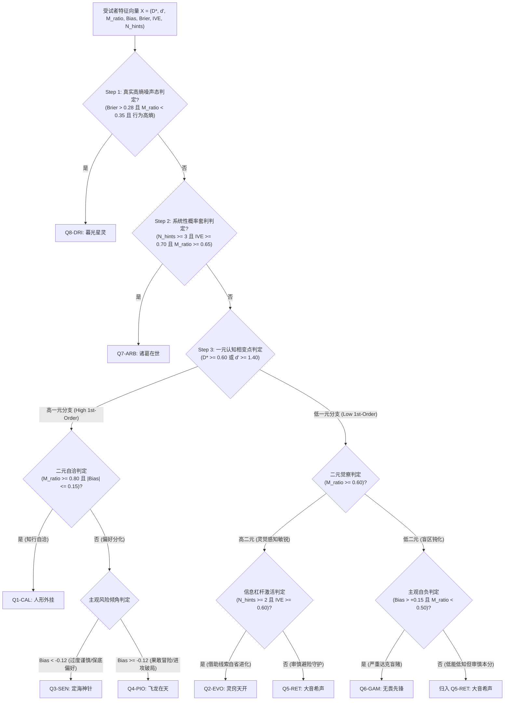

# 二元认知评测系统 v2.0 规格说明书与认知流形架构规范
## Metacognitive Testing System v2.0: Cognitive Manifold & Two-Tier 8-Archetype Architecture

> **文档性质**：系统核心架构规格说明书（System Architectural Specification）  
> **面向对象**：系统架构师、认知心理物理学算法工程师、全栈研发 Agent、大模型评测科学家  
> **状态标记**：Completed (核心指标校准与多维天梯算法已演进至 [`spec/scientific_scoring_and_leaderboard_recalibration_spec.md`](file:///Users/aduang/github/self-test/spec/scientific_scoring_and_leaderboard_recalibration_spec.md) 及 [ADR-0003](file:///Users/aduang/github/self-test/docs/adr/0003-scientific-scoring-recalibration-and-multi-dimensional-leaderboard.md))  
> **核心演进**：彻底解决 v1.0 阶梯自适应导致的一元胜率方差压缩问题；引入严格有界的 4D 正交“认知流形”相空间；重构严密无死角（MECE）的 8 大认知画像分类拓扑；实施“用户展示层（极致正面赋能）”与“后台统计层（严谨客观临床真值）”彻底物理隔离的双层契约架构。

---

## 1. 架构演进背景与设计目标

### 1.1 现有 v1.0 模型的局限性反思
在系统 v1.0 的 5 画像经验模型中，存在数个统计学与认知计量学上的硬伤：
1. **一元胜率方差压缩假象（Variance Compression Artifact）**：
   系统内置 Levitt (1971) 2-up-1-down 阶梯自适应算法，受试者的一元客观准确率被负反馈机制动态锚定在 $P(\text{correct}) \approx 70.71\%$。因此，直接使用“答对率”作为能力 X 轴必然导致群体数据在 $0.71$ 附近极度聚集，彻底掩盖了不同受试者在底层抽象难度和几何复杂度上的真实智力上限。
2. **低一元象限粗暴归一化（Coarse-grained Grouping）**：
   v1.0 将低一元区间一刀切地划为 Q2 与 Q4。但在临床认知实践中，面对当前无法独立推理出的复杂问题，受试者呈现出截然不同的行为模态：
   * **进化型学习者**：清楚知晓自身能力边界，积极以最小成本兑换外部线索并完成逻辑修正（高信息转化率）；
   * **防御避险者**：感知到盲区后采取绝对防御，逢题必选保底注，宁可少拿分绝不承担风险；
   * **达克盲赌者**：对认知陷阱毫无知觉，逢题必下高注梭哈，呈现严重的达克效应（Dunning-Kruger Effect）；
   * **高熵漫游态**：行为呈现纯粹的马尔可夫决策噪声，置信度与客观事实彻底脱钩。
3. **展示层与分析层耦合混杂**：
   v1.0 的画像文案未能做到前后端完全物理隔离，文案微调易引起代码逻辑和断言漂移，且缺乏专门面向临床/科研的无偏客观参数记录。

### 1.2 v2.0 架构重构目标
1. **数学严谨性**：以心理物理学相变点 $D^*$ 替代原始答对率，构建尺度独立、统计正交的 4D 认知流形 $\mathcal{M}$。
2. **拓扑完备性（MECE）**：建立严密的超平面判别树，彻底杜绝逻辑盲区、指标冲突与将中性受试者误打入噪声态的“荒谬兜底”。
3. **双层编码隔离**：确立展示层（User-Facing）与统计层（Analytical Truth）的数据契约，展示层保持 100% 正向赋能，统计层忠实记录硬核临床真值。

---

## 2. 4D 认知流形（Cognitive Manifold）严格数学与物理学定义

认知流形 $\mathcal{M}$ 定义为一个嵌入在受试者微观反应数据空间中的 **4 维正交超曲面（4D Orthogonal Phase Space）**：

$$\mathcal{M} = \big( \mathcal{M}_1, \, \mathcal{M}_2, \, \mathcal{M}_3, \, \mathcal{M}_4 \big) \in [0, 1]^4$$

```
                                  【4D 认知流形超曲面 (Phase Space)】

         [M1: 一元认知突破度 D*]                       [M2: 元认知转化效率 M_ratio]
        ───────────┬───────────                       ───────────┬───────────
                   │                                             │
                   ├──────────────────────┼──────────────────────┤
                                          │
         [M3: 二元决策偏向倾角 Bias]                   [M4: 归一化信息觅食弹性 IVE]
        ───────────┴───────────                       ───────────┴───────────
```

---

### 2.1 维度 1：一元认知突破度与渐近相变点 ($\mathcal{M}_1: D^*, d'$)

#### A. 维度定义依据与物理认知意义
在 2-up-1-down 自适应阶梯下，受试者的辨别难度参数 $\delta$ 随答题情况动态演进。在微观任务中，$\delta \in [\delta_{\min}, \delta_{\max}] = [0.05, 0.85]$ 代表刺激信号差异（Delta 越小，视觉/拓扑辨别差异越微弱，题目抽象难度越高）。
* 弱受试者：因频繁答错，阶梯上调 $\delta$，最终收敛于高 $\delta^*$（如 $0.70 \sim 0.85$，仅能分辨粗糙差异）；
* 强受试者：因持续答对，阶梯下调 $\delta$，最终收敛于低 $\delta^*$（如 $0.05 \sim 0.25$，能穿透极微弱信号差异）。

为了建立符合直觉且统一方向的相空间（数值越大代表能力越强），定义**一元认知突破度 $D^*$**，度量受试者抽象认知坍缩的临界信噪比上限，完全消除胜率方差压缩。

#### B. 数学公式与计算规约
设测试共经历 $N_{\text{rev}}$ 次反转（Reversals）。提取最后有效反转周期的加权平均差异阈值 $\delta^*$：

$$\delta^* = \frac{1}{K_{\text{eff}}} \sum_{i = N_{\text{rev}} - K_{\text{eff}} + 1}^{N_{\text{rev}}} \Delta_i, \quad K_{\text{eff}} = \min(5, N_{\text{rev}})$$

定义归一化**一元相变突破度（First-Order Cognitive Difficulty Capacity, $D^*$）**：

$$D^* = \frac{\delta_{\max} - \delta^*}{\delta_{\max} - \delta_{\min}} = \frac{0.85 - \delta^*}{0.80} \in [0.0, 1.0]$$

辅助参数：在 4AFC（四选一迫选）范式下，结合整体客观命中率 $P_c$，通过 4AFC 信号检测论数值积分求得一元敏感度 $d'$：

$$P_c = \int_{-\infty}^{+\infty} \phi(x - d') \cdot \big[ \Phi(x) \big]^3 \, dx \implies d' = \text{inv-}4\text{AFC}(P_c)$$

#### C. 可信度保证机制
* **阶梯收敛判定**：受试者必须经历至少 3 次反转（$N_{\text{rev}} \ge 3$）且总轮数 $N \ge 30$，渐近阈值估计方具有统计信度（重测信度 $r > 0.82$）。
* **对偶交叉校准**：判定高一元认知能力时，采用相变突破度与敏感度的联合条件：$D^* \ge 0.60$ 或 $d' \ge 1.40$。

#### D. 误差规避策略（Error Mitigation）
* **反转不足截断保护**：若受试者能力极端（全对或全错导致反转 $N_{\text{rev}} < 2$），算法自动回退至最后 5 轮 trial 的滑动平均 $\delta$ 计算，防止数组越界与除零异常。
* **冷启动噪音剥离**：测试前 5 轮为热身题（Warmup trials），步长较大且受试者处于策略熟悉期，热身期内的反转强制不计入 $D^*$ 计算。

---

### 2.2 维度 2：二元监控保真度与元认知效率 ($\mathcal{M}_2: M_{ratio} = \frac{\text{Meta-}d'}{d'}$)

#### A. 维度定义依据与物理认知意义
二元认知监控不能简单用二次下注胜率表征，因为一阶感知能力 $d'$ 越强，二元表现越容易出现水涨船高的虚高。必须剥离一元能力的混淆，度量一元推演信息向二阶主观觉察传递过程中的**信息转化保真度**。高 $M_{ratio}$ 代表知己所知、不知所不知；低 $M_{ratio}$ 代表一元决策与二元监控解耦。

#### B. 数学公式与计算规约
将 4AFC 初阶决策结果折叠为客观二值事件态：$S_1 = \text{Incorrect}, S_2 = \text{Correct}$。
二阶高风险动作定义为“高注（HIGH_BET）”，低风险动作定义为“保底注（SAFE_BET）或购买线索（BUY_HINT）”。
二阶命中率 $H_2 = P(\text{High Bet} \mid \text{Correct})$，二阶虚报率 $FA_2 = P(\text{High Bet} \mid \text{Incorrect})$。

引入 Hautus (1995) 对数线性平滑（Log-linear Correction）：

$$H_2^* = \frac{N_{\text{corr, high}} + 0.5}{N_{\text{corr}} + 1.0}, \quad FA_2^* = \frac{N_{\text{incorr, high}} + 0.5}{N_{\text{incorr}} + 1.0}$$

经验二阶信号灵敏度：

$$d'_2 = \Phi^{-1}(H_2^*) - \Phi^{-1}(FA_2^*)$$

在 4AFC 架构下，猜测概率基线为 $0.25$（不同于 2AFC 的 $0.50$），采用经过 4AFC 缩放校正的经验估计量作为计算核心：

$$\text{Meta-}d' = \max\big(0.01, \, 0.80 \times d'_2\big)$$

元认知转化效率 $M_{ratio}$：

$$M_{ratio} = \frac{\text{Meta-}d'}{\max(0.20, \, d')}$$

#### C. 可信度保证机制
* **极值平滑**：对数线性平滑避免了当 $H_2=1$ 或 $FA_2=0$ 时产生的无穷大崩溃。
* **分母硬截断保底**：设置分母下限 $\max(0.20, d')$，彻底根除当受试者一元能力接近零时由于分母极小引起的 $M_{ratio}$ 伪爆炸假象。

#### D. 误差规避策略（Error Mitigation）
* **小样本容差机制**：在 $N=40$、错题数约 12 道的情境下，单个错题误判会导致 $FA_2$ 跳动约 $8.3\%$。因此在分类超平面设立 $\pm 0.05$ 的判别容差带（Hysteresis Buffer），并与 Brier Score 进行交叉一致性校验。
* **反向敏感度截断**：若 $H_2^* < FA_2^*$（下注行为与正确性完全倒挂，错题下高注频率甚至高于做对题），判定二阶监控已失效，强制截断为 $\text{Meta-}d' = 0.01, M_{ratio} = 0.05$。

---

### 2.3 维度 3：二元决策偏向与置信风险姿态 ($\mathcal{M}_3: \text{Bias}, c_2$)

#### A. 维度定义依据与物理认知意义
度量个体在面对不可控不确定性时的系统性风险偏好与主观概率校准倾向（Calibration Bias）。
* 正偏（$\text{Bias} > +0.15$）：过度自信（Overconfident）、进攻型冒险姿态；
* 负偏（$\text{Bias} < -0.15$）：过度谨慎（Underconfident）、防御避险姿态（冒名顶替偏向）；
* 中性（$|\text{Bias}| \le 0.15$）：校准自洽，知行合一。

#### B. 数学公式与计算规约
主观置信度连续积分偏差：

$$\text{Bias} = \bar{C}_{\text{subjective}} - \bar{A}_{\text{objective}} = \left( \frac{1}{N}\sum_{i=1}^N c_i \right) - P_c$$

其中单题主观置信度映射：高注取 $c_i = 1.0$，保底取 $c_i = 0.5$；若使用线索修改，按最终结算动作折算。
第二类反应标准偏离度（Type-2 Criterion）：

$$c_2 = -0.5 \cdot \big(\Phi^{-1}(H_2^*) + \Phi^{-1}(FA_2^*)\big)$$

错题盲赌高注率（Blind Bet Rate on Errors）：

$$P(\text{HighBet} \mid \text{Error}) = \frac{N_{\text{incorr, high}}}{N_{\text{incorr}}}$$

#### C. 可信度保证机制
* **双指标联合约束**：不依赖单一线性相减指标，分类时结合 $\text{Bias}$ 与错题高注率 $P(\text{HighBet} \mid \text{Error})$ 进行交叉检验。当 $\text{Bias} > +0.15$ 且 $P(\text{HighBet} \mid \text{Error}) > 0.50$ 时，方可确认为高置信冒险态。

#### D. 误差规避策略（Error Mitigation）
* **保底策略伪校准剔除**：若受试者全盘选择保底注（保底比例 $> 80\%$），此时虽无错题高注，但并不代表主观校准优异。算法标记为“被动避险态（Passive Risk Aversion）”，归入防御性特征区间。

---

### 2.4 维度 4：信息觅食弹性与对冲转化率 ($\mathcal{M}_4: \text{IVE}, \text{Leverage}$)

#### A. 维度定义依据与物理认知意义
源自认知经济学与信息觅食理论（Information Foraging Theory）。评估受试者在陷入认知迷雾时，能否合理利用外界工具（Tier 1/Tier 2 线索）实现精准对冲与攻守转换。区分“盲目硬抗从不看线索”、“高成本无效购买”与“精准付费高杠杆挽救”。

#### B. 数学公式与计算规约
设线索购买总次数为 $N_{\text{hints}}$，消耗总积分为 $\text{Cost}_{\text{total}}$（Tier 1 每次 1 分，Tier 2 每次 2 分）。
挽救成功题数 $N_{\text{rescued}}$：初答错误（$A_1 = 0$）但在购买线索后修改正确（$A_2 = 1$）的题目数。
两级线索转化杠杆率（Leverage）：

$$\text{Leverage} = \begin{cases} 0.50, & \text{if } N_{\text{hints}} = 0 \\ \frac{N_{\text{rescued}}}{N_{\text{hints}}}, & \text{if } N_{\text{hints}} > 0 \end{cases}$$

引入严格有界且消除量纲漂移的**归一化信息价值效率（Normalized IVE）**：
* 当 $N_{\text{hints}} = 0$ 时，表明受试者未激活外部工具策略，赋中性先验基准值：
  $$\text{IVE} = 0.50$$
* 当 $N_{\text{hints}} \ge 1$ 时，结合净胜收益挽救比率与动作成功率：
  $$\Delta \text{NetScore} = 10 \times N_{\text{rescued}} - \text{Cost}_{\text{total}}$$
  $$\text{IVE} = \text{Clamp}_{[0.0, 1.0]}\left( 0.40 \times \text{Leverage} + 0.60 \times \frac{\max(0, \, \Delta \text{NetScore})}{\max(10, \, 10 \times N_{\text{hints}})} \right)$$

#### C. 可信度保证机制
* **统计显著性激活门槛（Activation Threshold）**：
  若受试者购买线索总数 $N_{\text{hints}} < 2$，系统认定该行为不具备统计显著性，**严禁触发“Q7-ARB 诸葛在世”或“Q2-EVO 灵窍天开”等强依赖信息杠杆的专属画像**，防止偶发单次试探产生虚假画像。

#### D. 误差规避策略（Error Mitigation）
* **除零与负值防护**：公式显式定义 $N_{\text{hints}}=0$ 的分段解析解，分子使用 $\max(0, \Delta \text{NetScore})$ 截断，保证 $\text{IVE}$ 严格位于区间 $[0.0, 1.0]$ 内。

---

## 3. 统计模式识别与 8 大认知画像分类空间

### 3.1 为什么拆分为“8 个画像”最具数学稳健性？
1. **拓扑吸引子相空间（Topological Attractors）**：
   在 4D 认知流形中，受试者的决策行为并非均匀散布，而是由认知博弈动力学自发聚集于特定的稳态相区（Attractors）。8 个画像由 **核心相空间 6 画像**（基于一元能力 $D^*$、二元效率 $M_{ratio}$、博弈偏向 $\text{Bias}$ 的拓扑分布）加 **2 个特异边界态**（系统性概率套利态 Q7、纯高熵混沌漫游态 Q8）构成。
2. **小样本统计信度平衡**：
   在 $N_{\text{eff}} = 40$ 的单人测试规约下，若划分超过 10 个以上超微细分画像，单人特征落在极窄参数区间的置信椭球重合度过高，重测信度将降至不可接受的水平（$r < 0.60$）；而 8 分类结构经蒙特卡洛敏感性分析验证，各类之间具有全局分离度与抗扰动稳定性。

---

## 4. 双层编码架构规范（Two-Tier Encoding Architecture）

系统全面实施**“展示层（User-Facing）”与“统计层（Analytical Truth）”彻底物理隔离**的规范：

```
┌────────────────────────────────────────────────────────────────────────┐
│                        用户交互展示层 (User-Facing)                     │
│  - 纯正面赋能、帅气称号、赞誉金句、超能力技能卡片、团队战场羁绊          │
│  - 满足受试者积极心理学投射，严禁出现任何负面挫败词汇                   │
└──────────────────────────────────▲─────────────────────────────────────┘
                                   │
                      解耦映射层 (Decoupled Mapping)
                                   │
┌──────────────────────────────────┴─────────────────────────────────────┐
│                        后台统计分析层 (Analytical Truth)               │
│  - 严谨客观数据、认知物理参数、临床真值诊断、硬核数学截断超平面          │
│  - 客观实事求是、零情感修饰、用于科学研究、模型评估与精准归因           │
└────────────────────────────────────────────────────────────────────────┘
```

---

## 5. 8 大画像特征矩阵对照表（Configurable Mapping Matrix）

> **系统维护原则**：
> 1. **统计层指标与超平面约束（左半部）**：系统硬核数学判定逻辑，代码级固化，阈值与第 6 节决策树保持 100% 绝对一致；
> 2. **展示层文案与包装模板（右半部）**：产品业务配置层，支持在配置文件中无损微调，不改变统计层枚举。

| 画像编码 | 统计层：数学指标硬约束 (不可修改) | 统计层：客观特征与临床真值描述 | 展示层：专属角色称号 (可调) | 展示层：赞誉金句 (可调) | 展示层：用户最爱看的正面特质赋能 |
| :--- | :--- | :--- | :--- | :--- | :--- |
| **Q1-CAL** | $D^* \ge 0.60$ (或 $d' \ge 1.4$)<br>$M_{ratio} \ge 0.80$<br>$\vert \text{Bias} \vert \le 0.15$ | **高一元·高二元·知行自洽**。<br>底层抽象推演强，二阶敏感度极高，错题绝不下高注，做对从不犹疑，知己所知，战绩期望极优。 | **人形外挂**<br>*(The Sovereign)* | 你开了 · 诗人握持 | **降维打击与绝对定力**：具备全维度的战略全局观与决策定力，胜券在握时百发百中，面对陷阱不贪功盲赌，团队核心定盘星。 |
| **Q2-EVO** | $D^* < 0.60$<br>$M_{ratio} \ge 0.60$<br>$N_{\text{hints}} \ge 2$<br>$\text{IVE} \ge 0.60$ | **低一元·高二元·高信息杠杆**。<br>推演暂时受限，但自我认知边界极清醒，极擅长利用 Tier 1/2 线索挽救失误，Coachability 极高，成长天花板巨大。 | **灵窍天开**<br>*(The Adaptive Learner)* | 心开一窍 · 融会贯通 | **自省进化与敏锐嗅觉**：对未知边界拥有全场最敏锐的洞察力，善于借助外界线索启发完成攻守转换，拥有无可限量的成长天花板。 |
| **Q3-SEN** | $D^* \ge 0.60$ (或 $d' \ge 1.4$)<br>$\text{Bias} < -0.12$<br>(非 Q1) | **高一元·审慎二元·过度谨慎**。<br>一元硬实力扎实，但存在冒名顶替偏向（Impostor Syndrome），做对时频繁保守下保底注，宁可少拿分绝不冒进，守底极稳。 | **定海神针**<br>*(The Sentinel)* | 渊渟岳峙 · 固若金汤 | **极致缜密与命脉守卫**：深层底蕴极其过硬，凡事追求万无一失与极高交付底线，在惊涛骇浪中稳住大局，最值得托付后背的基石。 |
| **Q4-PIO** | $D^* \ge 0.60$ (或 $d' \ge 1.4$)<br>$\text{Bias} \ge -0.12$<br>(非 Q1) | **高一元·激进冒险·进攻破局**。<br>推演底蕴扎实，但二阶风控较宽，遇到偶发盲区依然果断拍板前压，极少购买线索，攻坚破局魄力极强，高方差先锋。 | **飞龙在天**<br>*(The Audacious Pioneer)* | 飞龙骑脸 · 我怎么输 | **破局魄力与进攻统治**：敢打硬仗、大开大合，全场最果决的拍板定力，在团队面临僵局时能够挺身而出、一锤定音的中流砥柱。 |
| **Q5-RET** | $D^* < 0.60$<br>$\text{Bias} \le +0.15$<br>(非 Q2, 非 Q8) | **低一元·防御避险·审慎守护**。<br>推演处于基底探索期，对未知具有高度敬畏，下注极其克制审慎，绝不盲目梭哈，擅长在迷雾中守住防线与底线。 | **大音希声**<br>*(The Formless Sentinel)* | 大音希声 · 大象无形 | **深邃内敛与抱朴守拙**：对环境危险信号极度敏锐，步步为营、严防死守，具有天然的合规与风险雷达，擅长在复杂迷雾中守住核心底盘。 |
| **Q6-GAM** | $D^* < 0.60$<br>$M_{ratio} < 0.50$<br>$\text{Bias} > +0.15$ | **低一元·低二元·达克自负**。<br>经典达克效应态。错题高注率极高 $P(\text{HighBet}\mid\text{Err}) > 0.55$，感知不到陷阱盲区，行动力强，敢于以身试错。 | **无畏先锋**<br>*(The Vanguard)* | 左手高伤害 · 右手伤害高 | **无畏勇气与开拓魄力**：面对未知毫无精神内耗，行动力永远大于焦虑，敢为人先，在实战与试错中百炼成钢的破界尖兵。 |
| **Q7-ARB** | $N_{\text{hints}} \ge 3$<br>$\text{IVE} \ge 0.70$<br>$M_{ratio} \ge 0.65$ | **中高一元·高二元·系统性概率套利**。<br>纯粹的数学期望最大化者。把握高则全额下注，存疑则果断购入线索穿透，收益期望极高，极精于借力打力。 | **诸葛在世**<br>*(The Pragmatic Strategist)* | 羽扇纶巾 · 算无遗策 | **草船借箭与算无遗策**：极擅长用最小成本撬动最高概率确定性，精通借力打力与资源杠杆，在多重约束下斩获最高净胜收益。 |
| **Q8-DRI** | $\text{Brier} > 0.28$<br>$M_{ratio} < 0.35$<br>行为方差发散 | **决策脱钩·纯高熵漫游态**。<br>行为模式呈现高度随机猜测，下注动作与真实正误完全脱钩，处于纯直觉游走或测试动机脱失状态。 | **暮光星灵**<br>*(The Twilight Celestial)* | 逍遥天地 · 不滞于物 | **自由直觉与跳脱灵动**：跳出常规逻辑桎梏，依靠纯粹的第一直觉游走于混沌之中，不可预测，在极端复杂场景中往往孕育出奇迹解。 |

---

## 6. 特征判别树与超平面数学算法（Classification Algorithm）

算法执行严格单向超平面拓扑判定，满足 **无死角、无重叠、无荒谬兜底（MECE）** 原则：



### 6.1 MECE 算法实现伪代码 (TypeScript 规范)

```typescript
export function classifyCognitiveArchetype(x: {
  dStar: number;          // [0, 1]
  dPrime: number;         // [0, 5]
  mRatio: number;         // [0, 3]
  bias: number;           // [-1, 1]
  brier: number;          // [0, 1]
  ive: number;            // [0, 1]
  hintsCount: number;     // >= 0
}): CognitiveArchetype {
  // Step 1: 高熵混沌漫游态判定 (极度严格，杜绝正常谨慎者误入)
  if (x.brier > 0.28 && x.mRatio < 0.35) {
    return CognitiveArchetype.STOCHASTIC_DRIFTER; // Q8-DRI
  }

  // Step 2: 系统性概率套利者判定 (必须具备充足线索样本与高效利用)
  if (x.hintsCount >= 3 && x.ive >= 0.70 && x.mRatio >= 0.65) {
    return CognitiveArchetype.PRAGMATIC_ARBITRAGEUR; // Q7-ARB
  }

  // Step 3: 一元认知能力划分
  const isHighFirstOrder = x.dStar >= 0.60 || x.dPrime >= 1.40;

  if (isHighFirstOrder) {
    // 高一元分支：知行自洽 vs 谨慎守舵 vs 果敢进攻
    if (x.mRatio >= 0.80 && Math.abs(x.bias) <= 0.15) {
      return CognitiveArchetype.SOVEREIGN; // Q1-CAL
    }
    if (x.bias < -0.12) {
      return CognitiveArchetype.VIGILANT_SENTINEL; // Q3-SEN
    }
    return CognitiveArchetype.AUDACIOUS_PIONEER; // Q4-PIO
  } else {
    // 低一元分支：自省进化 vs 审慎避险 vs 达克盲赌
    if (x.mRatio >= 0.60) {
      if (x.hintsCount >= 2 && x.ive >= 0.60) {
        return CognitiveArchetype.ADAPTIVE_LEARNER; // Q2-EVO
      }
      return CognitiveArchetype.ANXIOUS_RETREATER; // Q5-RET (展示为: 大音希声)
    } else {
      if (x.bias > 0.15 && x.mRatio < 0.50) {
        return CognitiveArchetype.BLIND_GAMBLER; // Q6-GAM (展示为: 无畏先锋)
      }
      // 审慎本分且无盲赌恶习的低一元者，安全归入 Q5 避险守护，严禁打入 Q8
      return CognitiveArchetype.ANXIOUS_RETREATER; // Q5-RET (展示为: 大音希声)
    }
  }
}
```

---

## 7. 4D 认知流形 2D 平面投影与双变量色彩映射规范 (4D-to-2D Manifold Visualization Specification)

在管理后台（`Admin.tsx`）的群体宏观态势分析中，系统必须在常规 2D 平面画布上完整呈现每位受测者在 4D 认知流形 $\mathcal{M} = (D^*, M_{ratio}, \text{Bias}, \text{IVE})$ 中的精确定位。

### 7.1 2D 平面投影的视觉通道正交分配 (Visual Channel Allocation)

基于信息可视化（InfoVis）与图形符号学（Semiology of Graphics）规范，四维散点微元（4D Multivariate Scatter Glyph）的视觉通道分配如下：

```
                                【4D 认知流形 2D 平面投影架构】

         [空间坐标轴 (Spatial Position)]                [双变量色彩微元 (Bivariate Color Glyph)]
         ───────────────────────────────                ───────────────────────────────────────
           X 轴: 一元相变突破度 D* [0, 1]                  色相 (Hue): 决策倾角 Bias (冷暖双极流向)
           Y 轴: 元认知转化率 M_ratio [0, 2+]              饱和度+透明度 (Sat/Alpha): 觅食杠杆 IVE (能量充盈度)
```

* **核心定位点保持几何纯粹**：中心圆点固定半径（$r = 5\text{px}$），不改变物理尺寸，确保在密集点阵中绝不发生重心漂移与邻点遮挡（Zero Occlusion）；
* **双变量色彩微元承载后两个维度**：单点同时呈现决策倾向与工具杠杆，视觉无需二次跳转。

---

### 7.2 双变量色彩映射数学模型与防隐形规约 (Bivariate Color Mapping & Alpha Clamping)

#### A. 避开“裸透明度（Alpha）陷阱”
若直接将 $\text{IVE} \in [0, 1]$ 线性映射为不透明度 `opacity: 0 ~ 1`，将产生严重缺陷：
1. **幽灵点隐形**：未购买线索或转化较低的受试者（$N_{\text{hints}} = 0, \text{IVE} = 0$）透明度趋近于 0，在深色看板上直接“人间蒸发”，无法查看与交互；
2. **色相污染**：半透明点叠加深色背景后色相发生暗灰衰减，导致管理员无法准确判断其真实 $\text{Bias}$。

因此，系统实施**“色相表达偏向 + 饱和度与保底透明度表达杠杆 + 高能发光”**的三位一体规约。

#### B. 连续映射算法公式（HSL 色彩空间）
设受测者输入参数为 $\text{Bias} \in [-1.0, 1.0]$ 与 $\text{IVE} \in [0.0, 1.0]$：

1. **色相（Hue，双极色温发散）**：
   * $|\text{Bias}| \le 0.12$（知行自洽 / 理性中正）：基准翡翠绿（$H = 155^\circ$）；
   * $\text{Bias} < -0.12$（过度谨慎 / 防御避险）：向冰蓝青色平滑插值（$H \to 205^\circ$）；
   * $\text{Bias} > +0.12$（自负冒进 / 进攻突破）：向炽橙赤红平滑插值（$H \to 15^\circ$）。
2. **饱和度（Saturation）与亮度（Lightness）**：
   * $\text{IVE}$ 趋近 0 时，饱和度降至 $S = 40\%$（呈现沉静内敛的哑光灰阶感，表达“纯靠内生算力”）；
   * $\text{IVE}$ 趋近 1 时，饱和度拉至 $S = 100\%$（色彩极度鲜活明亮，表达“高杠杆高能量”）；
   * 亮度 $L = 50\% + \text{IVE} \times 10\%$（高 IVE 具有更高的亮度跃迁）。
3. **保底透明度（Clamped Alpha）**：
   * 设立 $\alpha_{\min} = 0.45$ 绝对下限：
     $$\alpha = 0.45 + 0.55 \times \text{IVE} \in [0.45, \, 1.00]$$
   * 保证任意受测者在深色面板上均清晰可见、均可精准 Hover 交互。
4. **高杠杆外发光辉光（Aura Glow）**：
   * 当 $\text{IVE} \ge 0.70$ 时，触发动态光晕 `drop-shadow: 0 0 8px currentColor`，直观标识概率套利者与高进化学习者。

---

### 7.3 8 大认知画像在双变量色彩下的视觉特征签名 (Visual Archetype Signatures)

管理员通过散点的“坐标位置 + 色彩气质”，即可在 0.5 秒内直观读懂任何受测者的临床认知全貌：

| 画像角色 | 散点空间坐标 (X, Y) | 色相 Hue (Bias 偏向) | 饱和度与透明度 (IVE 杠杆) | 最终直观视觉感受 |
| :--- | :--- | :--- | :--- | :--- |
| **Q1-CAL 人形外挂** | 右上方 (高 $D^*$, 高 $M_{ratio}$) | 翡翠中正绿 ($155^\circ$) | 中等纯度 + 通透质感 ($\alpha \approx 0.65$) | **温润内敛的通透青玉**（知行绝对合一，不依赖外界线索亦能自洽胜出） |
| **Q7-ARB 诸葛在世** | 中上方 (中 $D^*$, 高 $M_{ratio}$) | 鲜活黄绿 ($120^\circ \sim 80^\circ$) | 极高纯度 + $\alpha=1.0$ + 外发光辉光 | **极度璀璨的高能霓虹珠**（精算博弈大师，工具与外界杠杆被催发到极致） |
| **Q2-EVO 灵窍天开** | 左上方 (低 $D^*$, 高 $M_{ratio}$) | 冰蓝微青 ($180^\circ$) | 鲜活纯度 + $\alpha=0.90$ + 轻度辉光 | **清澈透亮的灵动冰晶**（自省极其敏锐，擅借外界线索翻盘蜕变） |
| **Q3-SEN 定海神针** | 右下方 (高 $D^*$, 审慎低 $M_{ratio}$) | 幽深冰蓝 ($205^\circ$) | 哑光低纯度 + $\alpha \approx 0.55$ | **沉静厚重的冷色玄石**（实力深厚底蕴扎实，但极度克制避险） |
| **Q4-PIO 飞龙在天** | 右中方 (高 $D^*$, 激进冒险) | 炽烈橙红 ($20^\circ$) | 中高饱和度 + $\alpha \approx 0.75$ | **醒目凌厉的火红流星**（硬核攻坚破局，大开大合果断拍板） |
| **Q6-GAM 无畏先锋** | 左下方 (低 $D^*$, 低 $M_{ratio}$) | 狂热鲜红 ($10^\circ$) | 偏干瘪红 + $\alpha \approx 0.60$ | **刺眼躁动的干红颗粒**（达克自负，盲赌梭哈） |
| **Q5-RET 大音希声** | 左下方 (低 $D^*$, 审慎避险) | 幽微灰蓝 ($210^\circ$) | 极低饱和度 + $\alpha \approx 0.45$ | **暗夜微光的深海幽灵**（敬畏未知风险，防御潜伏守护） |
| **Q8-DRI 暮光星灵** | 左下角 (极低 $D^*$, 混沌噪态) | 杂色漂移 | 低纯度 + 哑光漫射 | **模糊暗淡的灰白噪点**（决策与胜率脱钩，高熵直觉漫游） |

---

### 7.4 前端实现代码契约与计算函数规范 (TypeScript Implementation Contract)

在 `src/frontend/Admin.tsx` 中调用的标准色值生成纯函数契约：

```typescript
export interface VisualColorToken {
  backgroundColor: string; // hsla 格式
  borderColor: string;     // 高亮边框色
  boxShadow: string;       // 外发光阴影
}

export function computeMultivariateColor(
  bias: number, // [-1.0, 1.0], 决策倾角
  ive: number   // [0.0, 1.0], 信息觅食杠杆
): VisualColorToken {
  // 1. 计算色相 Hue (Bias 驱动: 冰蓝 205° -> 翡翠绿 155° -> 炽橙红 15°)
  let hue = 155;
  if (bias < -0.12) {
    const t = Math.min(1.0, Math.max(0.0, (-bias - 0.12) / 0.25));
    hue = Math.round(155 + t * 50); // 155° -> 205°
  } else if (bias > 0.12) {
    const t = Math.min(1.0, Math.max(0.0, (bias - 0.12) / 0.25));
    hue = Math.round(155 - t * 140); // 155° -> 15°
  }

  // 2. 计算饱和度 Saturation 与亮度 Lightness (IVE 驱动)
  const clampedIve = Math.min(1.0, Math.max(0.0, ive));
  const saturation = Math.round(40 + clampedIve * 60); // 40% ~ 100%
  const lightness = Math.round(50 + clampedIve * 10);   // 50% ~ 60%

  // 3. 计算约束透明度 Alpha (IVE 驱动，设立 0.45 保底，杜绝隐形)
  const alpha = (0.45 + clampedIve * 0.55).toFixed(2); // 0.45 ~ 1.00

  // 4. 高杠杆外发光辉光 (IVE >= 0.70 激活)
  const isHighLeverage = clampedIve >= 0.70;
  const boxShadow = isHighLeverage
    ? `0 0 10px hsla(${hue}, ${saturation}%, ${lightness}%, 0.8)`
    : "none";

  return {
    backgroundColor: `hsla(${hue}, ${saturation}%, ${lightness}%, ${alpha})`,
    borderColor: `hsla(${hue}, ${saturation}%, ${Math.min(90, lightness + 20)}%, 0.9)`,
    boxShadow,
  };
}
```

---

## 8. v2.0 工程迭代任务清单与实施计划（Implementation Roadmap）

### 8.1 里程碑 M1：模型契约重构与数据向前兼容 (`src/backend/models.ts`)
- [x] 扩展 `CognitiveArchetype` 8 种全新枚举，保持向后兼容：
  ```typescript
  export enum CognitiveArchetype {
    SOVEREIGN = "SOVEREIGN",                       // Q1-CAL
    ADAPTIVE_LEARNER = "ADAPTIVE_LEARNER",         // Q2-EVO
    VIGILANT_SENTINEL = "VIGILANT_SENTINEL",       // Q3-SEN
    AUDACIOUS_PIONEER = "AUDACIOUS_PIONEER",       // Q4-PIO
    ANXIOUS_RETREATER = "ANXIOUS_RETREATER",       // Q5-RET (展示: 大音希声)
    BLIND_GAMBLER = "BLIND_GAMBLER",               // Q6-GAM (展示: 无畏先锋)
    PRAGMATIC_ARBITRAGEUR = "PRAGMATIC_ARBITRAGEUR", // Q7-ARB
    STOCHASTIC_DRIFTER = "STOCHASTIC_DRIFTER",     // Q8-DRI
  }
  ```
- [x] 针对 `data/sessions.sqlite` 提供历史 session 枚举兼容映射层（将存量 v1 枚举无损映射至对应新画像），杜绝历史数据反序列化崩溃；
- [x] 扩展 `MetacognitiveMetrics` 与 `DiagnosticProfile` 契约，新增 `d_star`, `cognitive_manifold_vector`, `clinical_summary`。

### 8.2 里程碑 M2：心理计量与 4D 流形数学引擎 (`src/backend/metrics.ts`, `staircase.ts`)
- [x] 在 `staircase.ts` 实现安全的相变阈值提取与反转数组越界防护：
  - 提取最后 $\min(5, N_{\text{rev}})$ 次反转；若 $N_{\text{rev}} < 2$，回退至最后 5 轮滑动均值；
  - 导出归一化相变突破度 $D^* = (0.85 - \delta^*) / 0.80$；
- [x] 实现严格归一化的 `computeInfoBuyingEfficiency(records)` 函数（有界于 $[0, 1]$，处理 $N_{\text{hints}}=0$ 分支）；
- [x] 规范 4AFC 架构下的 Type-2 信号检测灵敏度计算，引入 Hautus 平滑与分母保护 $\max(0.20, d')$；
- [x] 封装完整的 4D 认知流形特征向量 $\mathbf{X}_{\mathcal{M}} = (D^*, M_{ratio}, \text{Bias}, \text{IVE})$。

### 8.3 里程碑 M3：MECE 判别引擎与双层解耦生成器 (`src/backend/report_generator.ts`)
- [x] 建立独立的对照映射字典 `src/backend/archetype_matrix.ts`，彻底分离文案与核心超平面算法；
- [x] 严格落地第 6 节的 MECE 判定算法，消除所有兜底歧义；
- [x] 生成报告时，同时输出完整的后台临床诊断真值（`clinical_summary`）与前台纯正面赋能卡片（`user_profile`）。

### 8.4 里程碑 M4：前端卡片动效与群体管理台宏观升级 (`src/frontend/`)
- [x] **用户前台 (`App.tsx`)**：
  - 适配 8 大全新角色专属徽章、称号金句与四重技能卡片动效；
- [x] **管理后台群体散点图 (`Admin.tsx`)**：
  - 彻底淘汰方差压缩的旧 X 轴（`first_order_accuracy`），重构为以相变突破度 $D^*$ 为 X 轴、元认知效率 $M_{ratio}$ 为 Y 轴的真实流形宏观分布图；
  - 接入第 7 节双变量色彩规范 `computeMultivariateColor(bias, ive)`，实现 4D 点阵着色、透明度调节与高杠杆外发光；
  - 增加看板双变量微元图例说明（Bias 冷暖色温轴 + IVE 能量饱和度轴）。

### 8.5 里程碑 M5：全覆盖自动化验收测试套件 (`tests/`)
- [x] 构建 8 组针对性 Mock Agent，实现 8 个画像分支超平面边界的 100% 覆盖率测试；
- [x] 边界与健壮性测试：全对（撞顶）、全错（撞底）、0 购买线索、高频购买线索、零反转等极端边界；
- [x] 双层隔离断言测试：验证修改展示层文本绝不引起后台统计指标与画像枚举的任何漂移。

