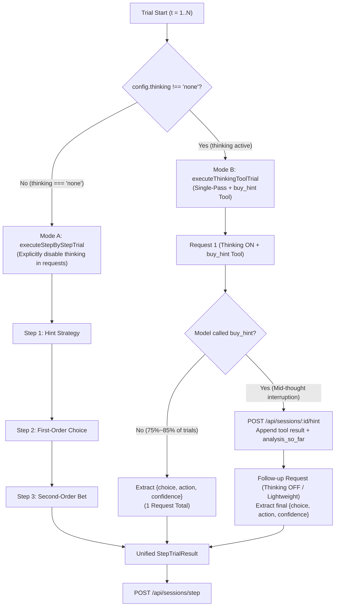

# Metacognitive v2.1: Dual-Mode Evaluation Architecture (Tool-Augmented Thinking & Multi-Step) Specification

## Problem Statement

When evaluating long-context reasoning models (such as Qwen 3/3.5 thinking variants, DeepSeek-R1, QwQ, or vision-enabled local architectures) alongside standard non-reasoning instruction models, a single rigid evaluation protocol causes severe bottlenecks:

1. **Redundant Multi-Step Thinking Explosion**: In the classic 3-to-4 step sequence (Hint Decision -> Tier 2 Hint Decision -> Choice -> Bet), when thinking is enabled, the model generates thousands of thinking tokens (4,000–8,000 tokens) at *every single step* for the exact same question. This leads to 15,000–25,000 tokens per trial and hours of latency.
2. **Implicit Thinking Leakage in Non-Thinking Mode**: When `thinking` is set to `"none"`, merely omitting `reasoning_effort` in API requests is insufficient for native reasoning models (e.g., Qwen3, DeepSeek-R1) hosted on local engines (Ollama, LM Studio, vLLM, llama.cpp), as their default chat templates still trigger `<think>...</think>` generation unless explicitly suppressed.
3. **Information Foraging vs. Single-Request Dilemma**: Removing hint purchasing in single-pass mode would degrade the 4D cognitive manifold (`[D*, M_ratio, Bias, IVE]`) to 3D by forcing Information Value Efficiency ($IVE$) to a static `0.50` prior. Conversely, naive multi-turn tool calls risk losing first-turn `<think>` traces due to inference engine Jinja templates stripping historical thoughts, causing the model to re-think the problem from scratch after receiving a hint.

---

## Solution

Introduce an **Auto-Adaptive Dual-Mode Evaluation Architecture** inside the existing [`src/cli/eval.ts`](file:///Users/aduang/github/self-test/src/cli/eval.ts) pipeline, branching directly by the `thinking` configuration while sharing 100% of session management, logging, telemetry, and reporting infrastructure:

1. **Mode A: Multi-Step Interactive Mode (`thinking === "none"`)**
   - Uses [`executeStepByStepTrial`](file:///Users/aduang/github/self-test/src/cli/eval.ts#L311-L571) (Step 1 Hint -> Step 1b Tier 2 Hint -> Step 2 Choice -> Step 3 Bet).
   - **Explicit Thinking Suppression**: [`LLMClient`](file:///Users/aduang/github/self-test/src/cli/lib/llm_client.ts) explicitly dispatches thinking-disable flags (`chat_template_kwargs: { enable_thinking: false }` / `reasoning_effort: "none"`, with automatic HTTP 400 fallback) to guarantee zero `<think>` token leakage during multi-step evaluation.

2. **Mode B: Tool-Augmented Single-Pass Thinking Mode (`thinking !== "none"`)**
   - Uses `executeThinkingToolTrial`, solving trials in a **single request** whenever no hint is needed, while supporting **mid-thought interruption and continuation** via native Tool Calling (`buy_hint`) when the model decides to purchase clues.
   - **Anti-Re-Thinking Preservation**: The `buy_hint` tool schema includes `analysis_so_far` to persist intermediate deductions in tool call arguments (which chat templates never strip), and follow-up post-hint resolution disables redundant full-problem re-thinking so each trial performs heavy reasoning **at most once**.
   - **Full 4D Manifold Integrity**: Both modes produce the standardized [`StepTrialResult`](file:///Users/aduang/github/self-test/src/cli/eval.ts#L297-L306) contract, preserving real hint unlocking, score costs, and genuine 4D `[D*, M_ratio, Bias, IVE]` scoring.

---

## User Stories

1. As an evaluation operator testing a thinking model (`thinking != "none"`), I want trials where the model does not need a hint to finish in **a single LLM request**, so that 75%–85% of trials complete with just one reasoning pass.
2. As a benchmark researcher, I want thinking models to be able to purchase Tier 1 or Tier 2 hints via a `buy_hint` tool call before committing to a final answer, so that Information Value Efficiency ($IVE$) and the 4D cognitive manifold remain 100% authentic.
3. As an operator running `thinking: "none"` (Multi-Step mode), I want the client to explicitly disable model thinking in the request payload, so that reasoning-capable models do not secretly generate `<think>` blocks across all 3–4 steps.
4. As an operator using local or cloud inference engines that strip historical `<think>` blocks in multi-turn tool calls, I want the `buy_hint` tool to capture `analysis_so_far` and avoid re-thinking the entire problem from scratch after receiving the hint.
5. As a developer maintaining the codebase, I want both execution modes to share the same CLI entry point ([`src/cli/eval.ts`](file:///Users/aduang/github/self-test/src/cli/eval.ts)), configuration wizard ([`src/cli/wizard.ts`](file:///Users/aduang/github/self-test/src/cli/wizard.ts)), logger ([`src/cli/lib/logger.ts`](file:///Users/aduang/github/self-test/src/cli/lib/logger.ts)), and [`StepTrialResult`](file:///Users/aduang/github/self-test/src/cli/eval.ts#L297-L306) return interface, avoiding duplicate scripts or fragmented aggregation logic.
6. As a user reviewing `--debug` logs, I want to clearly see whether a trial took the Multi-Step path or the Thinking-Tool path, including any `[tool_call]` and `[tool_result]` blocks when hints are purchased.

---

## Architecture & Implementation Decisions

### 1. Unified Entry Point & Automatic Branching (`src/cli/eval.ts`)

Both modes share the main trial loop in [`src/cli/eval.ts`](file:///Users/aduang/github/self-test/src/cli/eval.ts) and return the identical [`StepTrialResult`](file:///Users/aduang/github/self-test/src/cli/eval.ts#L297-L306) structure:



### 2. Explicit Thinking Control in `LLMClient` (`src/cli/lib/llm_client.ts`)

- **When `thinking === "none"` (or when a follow-up step explicitly overrides `thinking: "none"`)**:
  - Injects explicit thinking-suppression parameters:
    - `reasoning_effort: "none"` (for OpenAI / compatible endpoints)
    - `chat_template_kwargs: { enable_thinking: false }` (for vLLM / LM Studio / Qwen3 / DeepSeek templates)
  - **Resilient 400 Fallback**: If the target API rejects `reasoning_effort: "none"` or `chat_template_kwargs` with HTTP 400, `LLMClient` automatically strips the unsupported suppression field and retries transparently.
- **When `thinking !== "none"`**:
  - Sends `reasoning_effort: this.thinking` and `chat_template_kwargs: { enable_thinking: true }`.
  - Supports passing `tools` in the request payload and extracting `message.tool_calls` in the response.

### 3. Dynamic Zero-Parameter Clue Tools (`src/cli/lib/schema_builder.ts`)

1. **Tool Definitions (`BUY_HINT_TIER1_TOOL`, `BUY_HINT_TIER2_TOOL`)**:
   Tools require zero arguments (`properties: {}`), eliminating hallucination and redundant `analysis_so_far` fields, with costs explicit in descriptions:
```typescript
export const BUY_HINT_TIER1_TOOL = {
  type: "function",
  function: {
    name: "buy_hint_tier1",
    description: "当推演遇到瓶颈、条件存在歧义或无法唯一锁定正确选项时，调用此工具购买辅助线索（调阅第 1 级宏观线索，消耗 1 积分）。无须参数。若当前已能推导出答案，请勿调用此工具，直接输出最终 JSON 决策。",
    parameters: { type: "object", properties: {}, required: [], additionalProperties: false },
  },
};

export const BUY_HINT_TIER2_TOOL = {
  type: "function",
  function: {
    name: "buy_hint_tier2",
    description: "在已调阅第 1 级线索后若仍有疑问，调用此工具继续调阅第 2 级细节辅助线索（再消耗 2 积分，累计消耗 3 积分）。无须参数。若已能锁定答案，请勿调用此工具，直接输出最终 JSON 决策。",
    parameters: { type: "object", properties: {}, required: [], additionalProperties: false },
  },
};
```

2. **Single-Pass Final Decision Schema (`SINGLE_PASS_DECISION_SCHEMA`)**:
```typescript
export const SINGLE_PASS_DECISION_SCHEMA = createStrictSchema(
  "single_pass_metacognitive_decision",
  {
    choice: {
      type: "string",
      enum: ["A", "B", "C", "D"],
      description: "唯一选定的正确选项字母 (A / B / C / D)",
    },
    action: {
      type: "string",
      enum: ["HIGH_BET", "SAFE_BET"],
      description: "交付博弈策略：HIGH_BET (正确 +10，错误 -10) 或 SAFE_BET (固定 +3)",
    },
    confidence: {
      type: "number",
      minimum: 0.0,
      maximum: 1.0,
      description: "对所选选项的主观把握度 (0.0~1.0)",
    },
  },
  ["choice", "action", "confidence"]
);
```

### 4. Execution Protocol of `executeThinkingToolTrial`

1. **Initial Prompt Assembly**:
   - System message: `GAME_RULES_SYSTEM_PROMPT` + `THINKING_SINGLE_PASS_USER_PROMPT` (+ optional persona). Protocol instructions and rules are consolidated into `system` for optimal Prefix Caching.
   - User message: Exactly 1 pure stimulus message containing task prompt and options A–D. No redundant instruction messages.
2. **Pass 1 (Thinking Enabled + `tools: [BUY_HINT_TOOL]`)**:
   - Case 1 (**No Tool Call**): Model finishes thinking and outputs `{ choice, action, confidence }`. Recorded operations: `HINT_TIER1: DECIDE (cost: 0)`, `FIRST_ORDER_CHOICE`, `SECOND_ORDER_BET`. **Done in 1 request.**
   - Case 2 (**Tool Call `buy_hint` triggered**):
     - If `tier === 1`: Client calls `POST /api/sessions/:id/hint` once (`hintsUnlocked = 1, hintsCost = 1`).
     - If `tier === 2` (or if a subsequent Tier 2 tool call is made): Client unlocks up to Tier 2 (`hintsUnlocked = 2, hintsCost = 3`).
     - Client appends the assistant's `tool_calls` message (preserving intermediate `reasoning_content` and `analysis_so_far`) and the `{ role: "tool", tool_call_id, content: hintText }` message.
     - **Zero Redundant User Messages**: No extra user prompt is injected after the tool result.
3. **Post-Hint Interleaved Thinking**:
   - The client maintains the exact same `thinking` level (`reasoning_effort`) without forcing thinking off, enabling the model to absorb clue evidence via native Interleaved Thinking.
   - If the model only bought Tier 1 and still wants Tier 2, it may call `buy_hint(tier: 2)`, or directly output the final JSON `{ choice, action, confidence }`.
4. **Fallback for Non-Tool-Supporting Local Models**:
   - If a local endpoint returns HTTP 400 on `tools`, `LLMClient` automatically falls back to prompt-based JSON union (`{"strategy": "BUY_HINT", "tier": 1, "analysis_so_far": "..."}` vs `{"choice": "...", "action": "...", "confidence": ...}`), ensuring 100% compatibility across all local/cloud OpenAI-compatible servers.

### 5. Telemetry & Operations Compatibility

- Backend `/api/sessions/step` and [`PsychometricScorer`](file:///Users/aduang/github/self-test/src/backend/metrics.ts) require **zero changes**.
- `operations` array in `StepTrialResult` continues to record `HINT_TIER1`, `HINT_TIER2` (when applicable), `FIRST_ORDER_CHOICE`, and `SECOND_ORDER_BET`.
- Session metadata records `evaluation_mode: "thinking_tool" | "multi_step"`.

---

## Testing & Verification Criteria

1. **Explicit Thinking Suppression Test (`thinking: "none"`)**:
   - Verify that `LLMClient.query` attaches explicit thinking-disable fields when `thinking === "none"`, and gracefully retries on HTTP 400 if an endpoint rejects unknown parameters.
2. **Single-Request Direct Decision Test (`thinking !== "none"`, no hint needed)**:
   - Verify that when the model returns `{ choice, action, confidence }` without calling `buy_hint`, `executeThinkingToolTrial` makes **exactly 1 LLM request** and submits valid Phase 1 & Phase 2 data.
3. **Tool-Call Hint Interruption & Post-Hint Resolution Test (`thinking !== "none"`, hint purchased)**:
   - Verify that when the model returns a `buy_hint` tool call (Tier 1 or Tier 2), the runner calls `/api/sessions/:id/hint`, appends the tool response, resolves the final decision with thinking suppressed on the final synthesis step, and accurately records `hintsUnlocked`, `hintsCost`, and `IVE`.
4. **End-to-End Regression Suite**:
   - Existing multi-step tests in `tests/eval_flow.test.ts` and `tests/acceptance.test.ts` pass 100%.
